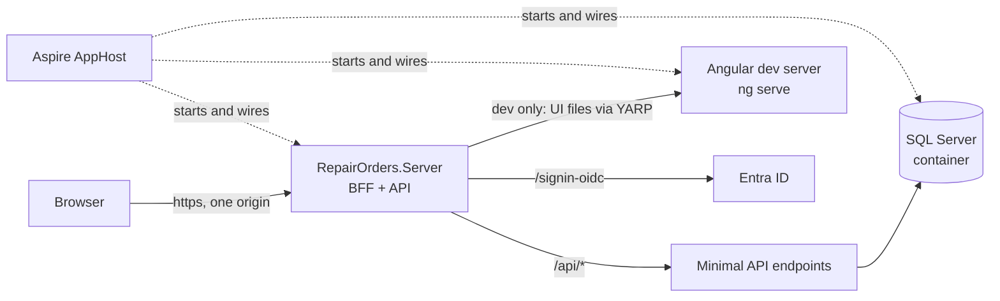
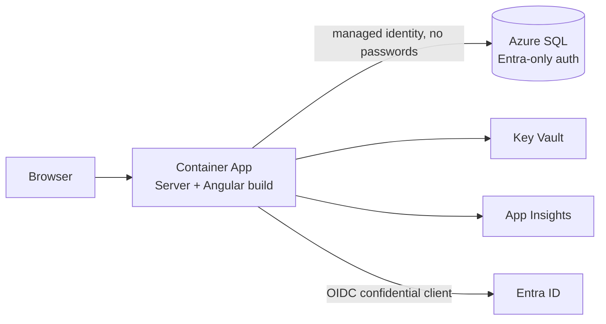
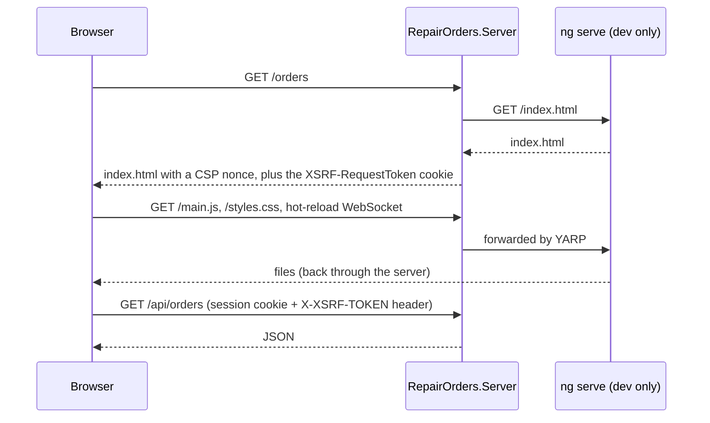
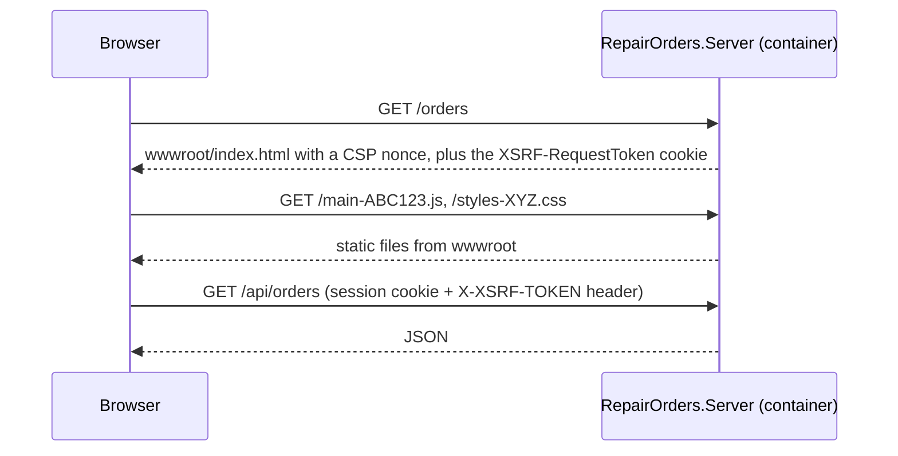
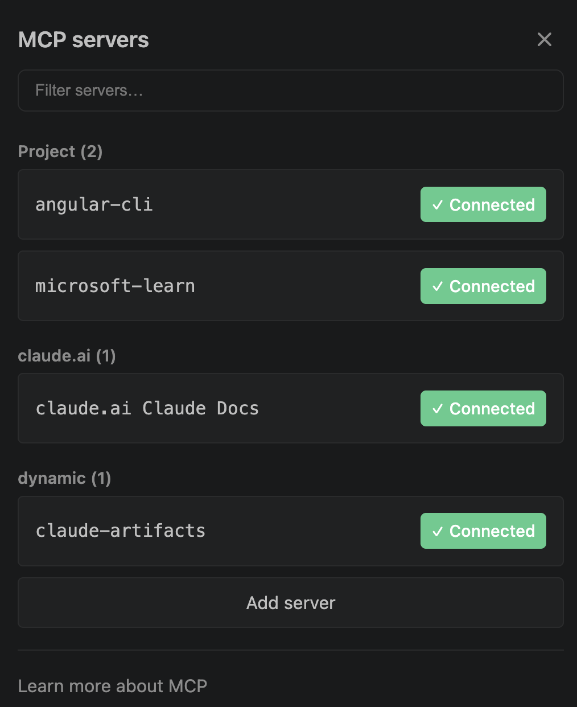

# bff-aspnetcore-angular
**Repair Orders**: a full-stack app for mechanics, built with Angular and ASP.NET Core using the Backend for Frontend (BFF) pattern. EF Core and SQL Server for data, Aspire for local dev, and Bicep + GitHub Actions to deploy to Azure.

I'm building it step by step to show how an enterprise .NET + Angular app fits together, from the browser to the database to the cloud.

## Helpful links
1. [damienbod/bff-aspnetcore-angular](https://github.com/damienbod/bff-aspnetcore-angular): the BFF security setup I follow (Angular 22, .NET 10)
2. [Aspire with JavaScript sample](https://aspire.dev/reference/samples/aspire-with-javascript/) ([code](https://github.com/microsoft/aspire-samples/tree/main/samples/aspire-with-javascript)): how to run Angular from an Aspire AppHost
3. [Aspire JavaScript integration](https://aspire.dev/integrations/frameworks/javascript/)
4. [Microsoft.Identity.Web](https://learn.microsoft.com/entra/msal/dotnet/microsoft-identity-web/)
5. [Angular docs](https://angular.dev/) · [Angular Material](https://material.angular.dev/)
6. [Azure Verified Modules (Bicep)](https://azure.github.io/Azure-Verified-Modules/indexes/bicep/)

## How the app works
A supervisor opens a **repair order** for a truck ("Unit 4127: brakes squealing") and assigns a mechanic. The mechanic adds **labor and parts lines**, marks them done, and **completes** the order.

| Feature | What it shows |
|---|---|
| Order list with a status filter (kept in the URL) | Components, signals, a feature store, routing |
| Create and edit in a dialog | Angular Material dialogs, typed reactive forms, validation in the UI **and** the API |
| Complete an order | A business rule (all lines must be done) and a **rowversion** concurrency check that returns **409** |
| Sign in with Entra ID as a Mechanic or Supervisor | The BFF pattern: cookie session, anti-forgery, app roles and authorization policies |

### Local dev
The ASP.NET Core server is the **only front door**. The browser always talks to one origin, so the auth cookie just works and there's no CORS. In dev, the server forwards UI requests to the Angular dev server with YARP, so hot reload still works. Aspire starts everything.



### In Azure
One container serves both the Angular build (from `wwwroot`) and the API.



### How Angular and ASP.NET Core run together, in dev and in production
In dev, Angular runs on its own dev server (`ng serve`) for hot reload. In production there's no dev server, just built files. There are three common ways to wire that up:

| Setup | Dev: what the browser hits | Production | Used by |
|---|---|---|---|
| **Angular dev server in front** | `ng serve`; its `proxy.conf.js` forwards `/api` to ASP.NET Core | ASP.NET Core serves the built files from `wwwroot` | Microsoft's [Angular and ASP.NET Core](https://learn.microsoft.com/visualstudio/javascript/tutorial-asp-net-core-with-angular) Visual Studio template |
| **Separate front end** | Same as above | Angular in its own nginx container that proxies `/api` to the API | Aspire's [aspire-with-javascript](https://github.com/microsoft/aspire-samples/tree/main/samples/aspire-with-javascript) sample |
| **Server in front (BFF)** ✅ | ASP.NET Core; it forwards UI requests to `ng serve` with [YARP](https://learn.microsoft.com/aspnet/core/fundamentals/servers/yarp/yarp-overview) | ASP.NET Core serves the built files from `wwwroot` | [damienbod's BFF sample](https://github.com/damienbod/bff-aspnetcore-angular), and this app |

I use the third one. In a BFF the server owns the session: the sign-in redirect to `/signin-oidc`, the session cookie, the anti-forgery cookie, the security headers and the CSP nonce in `index.html`. If `ng serve` were the front door in dev, none of that would run the way it does in production, and security bugs would only show up after a deploy. With the server in front, dev and production have the same front door and only the source of the UI files changes. The cost is a few YARP routes that exist only in dev.

**In dev.** The server fetches `index.html` from `ng serve` and adds the security bits. YARP forwards the JS, CSS and hot-reload traffic. The browser only ever talks to the server, so everything stays on one origin.



**In production.** `ng build` writes static files that end up in the server's `wwwroot`. There's no dev server and no YARP route. Deep links like `/orders/42` still get `index.html`, so Angular's router takes over.



In damienbod's code, the `_Host` Razor page renders `index.html` in both modes, and `MapReverseProxy()` is only called inside `if (app.Environment.IsDevelopment())`. Until I add auth (step 3), I start simpler: YARP forwards `index.html` too, and production uses `MapFallbackToFile("index.html")`.

## Design decisions
| Decision | Why | What I didn't pick |
|---|---|---|
| **BFF:** the server signs the user in, keeps the tokens, and gives the browser an HttpOnly cookie | No tokens in the browser, so an XSS bug can't steal them. One security context for the whole app (see [Why BFF](#why-bff-and-not-msal-in-the-browser)) | MSAL Angular with tokens in the browser: common in Microsoft samples, but the tokens are readable by JavaScript |
| **The BFF and the API are the same app.** YARP only proxies the Angular dev server, in dev | This is how damienbod's sample works. Same origin, no extra hop, one thing to secure | A separate API behind the BFF, with YARP forwarding calls and attaching an access token. Worth it when several APIs or teams are involved |
| **App roles + authorization policies** for Mechanic and Supervisor | Roles are assigned in Entra ID and arrive in the `roles` claim; policies check them on each endpoint | API **scopes**: I don't need them, because the browser never calls an API with a token. Scopes come in when the server calls a downstream API (like Microsoft Graph) on the user's behalf |
| **Angular CLI** | Standard tooling. Nothing here needs a monorepo tool | Nx |
| **Angular Material + CDK** | Free, made by the Angular team, accessible, has dialogs and tables | PrimeNG, or a paid suite (Syncfusion, Kendo, DevExtreme) for heavy data grids |
| **Plain CSS** with a Material prebuilt theme | Modern CSS has nesting and variables. Components style themselves with Material's `--mat-sys-*` CSS variables, so no Sass build step | SCSS: only needed for a custom Material theme (`mat.theme` mixin), which I can add later as a single file. Tailwind: a second styling system next to Material |
| **Signals for state, RxJS for streams;** a feature store provided on the route | The modern Angular default, and easy to read | NgRx: worth it when many features share complex state |
| **Aspire** for local dev | One command starts the server, Angular and SQL, with a dashboard and traces | docker-compose plus scripts |
| **Bicep with Azure Verified Modules**, in the azd folder layout | Infra is reviewed code, `what-if` previews changes, and Microsoft maintains the modules | Aspire-generated infra (a quick start, less control); Terraform |
| **Azure Container Apps** | The same hosting as my order-processing app; one container | App Service: simpler for a single web app |
| **GitHub Actions:** dev deploys automatically, prod needs approval; sign-in with OIDC | How teams ship, with no stored secrets | Deploying from my laptop with `azd up` (fine for dev only) |

## Why BFF, and not MSAL in the browser
### The problem with tokens in the browser
With MSAL Angular, the Angular app signs the user in itself and keeps the access and refresh tokens in the browser. Any script that runs on my page can read them: an XSS bug, or a compromised npm package. The script can send the tokens anywhere and use them until they expire. A browser app also can't keep a secret, so it can only be a *public* client.

### What BFF changes
The server does the sign-in instead. It's a *confidential* client (it has a secret or certificate), runs the OpenID Connect code flow with Entra ID, keeps the tokens on the server, and gives the browser only a session cookie. The browser attaches that cookie to every request to the same origin, so Angular never touches a token. The IETF's [OAuth 2.0 for Browser-Based Applications](https://datatracker.ietf.org/doc/draft-ietf-oauth-browser-based-apps/) calls BFF the most secure option for browser apps.

Because the Angular app and the server are deployed together on one origin, the app has **one security context**: one sign-in, one session, no CORS, no tokens to forward. Keeping the architecture this simple makes security easier to get right, and it's much harder to add later than to start with.

**Trade-offs I'd mention:**
- XSS is still bad. An injected script can call my API *as me* while the page is open. What it can't do is steal a token and use it somewhere else later. So I still add a Content Security Policy and security headers, as damienbod's sample does.
- The server now holds sessions and tokens. With more than one instance, the token cache has to be shared (a distributed cache) instead of in memory.

### How the session cookie is protected
| Attribute | What it does |
|---|---|
| `HttpOnly` | JavaScript can't read the cookie (`document.cookie` doesn't show it). The browser still sends it. |
| `Secure` | Sent only over HTTPS. |
| `SameSite=Lax` | Not sent on cross-site POSTs, iframes or `fetch` calls. It *is* sent when I follow a link to the app from another site, so I stay signed in. ASP.NET Core's default for the auth cookie. |
| `SameSite=Strict` | Never sent on a request that starts on another site, not even a link. Safer, but the first page after clicking a link looks signed out. |
| `__Host-` name prefix | The browser only accepts the cookie if it's `Secure`, has `Path=/` and no `Domain`, so a subdomain can't set or overwrite it. damienbod uses it for the anti-forgery cookie. |

One exception: Entra ID returns the user to `/signin-oidc` with a cross-site POST, so the short-lived correlation and nonce cookies ASP.NET Core uses during sign-in are `SameSite=None`. The session cookie isn't.

### Anti-forgery on top of SameSite
SameSite isn't enough on its own. It works per *site*, not per origin, so a sibling subdomain counts as same-site, and `Lax` still allows cross-site GET navigations (so a GET must never change data). damienbod's sample adds an anti-forgery token: the server puts it in a readable cookie, an Angular interceptor copies it into an `X-XSRF-TOKEN` header on every API call, and the server rejects POST/PUT/DELETE requests without a valid one. Another site can't read my cookies, so it can't set that header.

### One session, step by step
| What happens | Result |
|---|---|
| I sign in at `https://myapp` | The server sets the session cookie: `HttpOnly; Secure; SameSite=Lax` |
| Angular calls `GET /api/orders` | The browser attaches the cookie; the server reads it and knows who I am. Angular's code never sees it |
| Something requests `http://myapp` | `Secure`: the cookie isn't sent over plain HTTP, and the server redirects to HTTPS |
| An injected script on my page reads `document.cookie` | `HttpOnly`: the session cookie isn't there |
| `evil.example` auto-submits a form that POSTs to `https://myapp/api/orders/42/complete` | `SameSite=Lax`: no cookie, so 401. Even if the cookie were sent, there's no `X-XSRF-TOKEN` header, so 400 |
| I click a link to the app in an email | `Lax`: the cookie is sent and I'm still signed in |

Note: a script on *another* site can never read my cookies; the browser's same-origin policy already stops that. `HttpOnly` is about scripts running on *my* page.

### Where I learned this
1. [End-to-end security in a web application](https://youtu.be/6cdV-oN_Yao) (talk)
2. [Implement a secure web application using Angular and an ASP.NET Core server](https://damienbod.com/2023/09/11/implement-a-secure-web-application-using-nx-standalone-angular-and-an-asp-net-core-server/) (damienbod)
3. [damienbod/bff-aspnetcore-angular](https://github.com/damienbod/bff-aspnetcore-angular)
4. [Azure-Samples: ASP.NET Core web app with OpenID Connect](https://github.com/Azure-Samples/active-directory-aspnetcore-webapp-openidconnect-v2)
5. [MDN: Set-Cookie](https://developer.mozilla.org/docs/Web/HTTP/Reference/Headers/Set-Cookie) and [ASP.NET Core anti-forgery](https://learn.microsoft.com/aspnet/core/security/anti-request-forgery)

## Angular conventions
I follow Angular's own [style guide](https://angular.dev/style-guide) and its [best practices for AI-assisted code](https://angular.dev/ai/develop-with-ai). In short:
- **Files:** hyphenated names (`order-list.ts`), one concept per file, tests next to the code (`order-list.spec.ts`), folders by feature (`orders/`), not by type (`components/`).
- **Components:** standalone (no NgModules, no `standalone: true`), `input()` / `output()` / `model()` instead of decorators, `computed()` for derived state, `host: {}` instead of `@HostBinding`.
- **State:** signals; `set()` / `update()`, never mutate.
- **Templates:** `@if` / `@for` / `@switch`; `[class.x]` and `[style.x]` instead of `ngClass` / `ngStyle`; complex logic moves into a `computed()`.
- **Members:** `inject()` instead of constructor injection; `protected` for what only the template reads; `readonly` for inputs, outputs and queries.
- **Routes:** lazy-loaded per feature.
- **Accessibility:** WCAG AA and AXE checks pass.

## Roadmap
1. **Local skeleton:** Aspire AppHost, the server, SQL Server, and the Angular app behind YARP. List repair orders. No auth yet.
2. **One complete feature:** create and edit in a dialog, labor and parts lines, complete with the 409 check, a signal store, ProblemDetails.
3. **BFF auth:** Entra ID sign-in, cookie, anti-forgery, Mechanic and Supervisor app roles.
   Then, to learn **scopes**: show the signed-in user's profile from Microsoft Graph (the server gets a token for `User.Read` on the user's behalf).
4. **Tests:** API integration tests (xUnit + Aspire testing), Angular component tests.
5. **Infra:** Bicep + AVM, `what-if`, deploy a dev environment.
6. **CI/CD:** build, test, deploy to dev, approve, deploy to prod.
7. *Maybe:* split the API into its own service behind the BFF with YARP, to learn token forwarding.

## Local setup
What I have: .NET SDK 10.0.400, Aspire CLI 13.6, Azure CLI 2.90, azd 1.35, Docker Desktop.

### Install Node
Angular 22 needs Node 24 (LTS). I use [mise](https://mise.jdx.dev/) instead of nvm. The Node version is pinned in a `mise.toml` checked into the repo, so anyone who clones the repo (and CI) gets the same version. One tool also covers other languages, not just Node.

I install it with Homebrew, like the rest of my tools, so `brew upgrade` keeps it current:
```bash
brew install mise
```
`mise -v` then suggests swapping to its own `curl https://mise.run | sh` installer because it's a bit faster. I skipped that: it's milliseconds per command, and it would mean a second updater and an extra PATH entry.

Then I put mise's shims on PATH (from mise's [shims guide](https://mise.jdx.dev/dev-tools/shims.html)). Shims are small stand-ins for `node` and `npm` that pick the version from the nearest `mise.toml` each time they run, so they work in my terminal and in apps like Rider and Aspire. macOS Terminal opens login shells, which read `~/.bash_profile`. I append one line to the end of it. It has to come after the existing `brew shellenv` line, which is what puts `mise` on PATH:
```bash
echo 'eval "$(mise activate bash --shims)"' >> ~/.bash_profile   # >> appends; > would overwrite the file
tail -3 ~/.bash_profile                                          # check it's the last line
source ~/.bash_profile                                           # load it into this terminal (new terminals do it themselves)
```
mise also has a second line, `eval "$(mise activate bash)"`, that hooks the prompt to load `[env]` vars from `mise.toml`. I don't use `[env]`, so the shims line is all I need.

Then pin Node for this repo:
```bash
cd ~/RiderProjects/bff-aspnetcore-angular
mise use node@24        # installs Node 24 and writes mise.toml
node -v && npm -v
```
`node -v` prints `v24.22.2`, and the new `mise.toml` is just:
```toml
[tools]
node = "24"
```
I also set Node 24 as my global default. I found this out the hard way: `aspire agent init` (step 3) runs `npm` in a temp folder, and with no global version mise's shim failed with `No version is set for shim: npm`. The repo still pins its own version:
```bash
mise use -g node@24     # writes ~/.config/mise/config.toml
```
mise then warns that `node is defined in .../mise.toml which overrides the global config`. That's expected: inside this repo the repo's pin wins, and everywhere else the global one applies.

### Start Docker
Aspire runs SQL Server in a container, so Docker has to be running.
```bash
open -a Docker
```

### Clone the reference samples
I keep official samples next to my repos and copy patterns from them instead of guessing.
```bash
mkdir -p ~/RiderProjects/_refs && cd ~/RiderProjects/_refs
git clone --depth 1 https://github.com/damienbod/bff-aspnetcore-angular damienbod-bff
git clone --depth 1 https://github.com/microsoft/aspire-samples
```
- `damienbod-bff/server/Program.cs`: Microsoft.Identity.Web sign-in, anti-forgery (`X-XSRF-TOKEN`), security headers, and YARP to the Angular dev server
- `aspire-samples/samples/aspire-with-javascript`: Angular in an AppHost with `AddJavaScriptApp(...).WithHttpEndpoint(env: "PORT")`

## Build it step by step
The Angular app is its own Angular CLI workspace, next to the .NET projects, not inside one. It only calls relative `/api/*` URLs, so it doesn't know or care what backend serves it, and it would work the same behind a Java or Python BFF. The two only meet at publish time, when the Angular build output is copied into the server's `wwwroot`. damienbod's sample uses the same split (`ui/` and `server/`).

```
RepairOrders.slnx
mise.toml                          # pins Node 24
src/
  RepairOrders.AppHost/            # Aspire: starts everything in dev
  RepairOrders.ServiceDefaults/    # OpenTelemetry, health checks, resilience
  RepairOrders.Server/             # BFF + API; serves the Angular build in production
  ui/                              # Angular CLI workspace (ng serve, ng build, npm)
tests/                             # later: integration and component tests
infra/                             # later: Bicep
```
The `.slnx` sits at the root, not in `src/`, like Microsoft's [eShop](https://github.com/dotnet/eShop). It covers `src/` and `tests/`, and repo-wide files like `global.json` and `Directory.Build.props` sit next to it and apply to everything below.

### 1. Create the solution
- **AppHost:** starts and wires everything locally.
- **ServiceDefaults:** OpenTelemetry, health checks and HTTP resilience, shared by every service.
- **Server:** the BFF and the API. It starts from the empty `web` template, so there's no code I didn't write.

Why not one `aspire new` command? None of the templates fits. `aspire-starter` adds a Blazor front end and a weather API I'd only delete. In Aspire 13.6, `aspire-empty` creates a single-file AppHost (`apphost.cs`) with no ServiceDefaults. `dotnet new aspire` makes a `.sln` with the projects at the root instead of in `src/`. So I run one template per project. It's a few more lines, but each one is a choice I can explain, and the project-based AppHost is what eShop and the Aspire samples use.

```bash
cd ~/RiderProjects/bff-aspnetcore-angular
dotnet new update                       # latest template patches (Aspire 13.6.0 → 13.6.4)
dotnet new sln -n RepairOrders          # .NET 10 creates RepairOrders.slnx
dotnet new aspire-apphost -n RepairOrders.AppHost -o src/RepairOrders.AppHost
dotnet new aspire-servicedefaults -n RepairOrders.ServiceDefaults -o src/RepairOrders.ServiceDefaults
dotnet new web -n RepairOrders.Server -o src/RepairOrders.Server
dotnet sln add src/RepairOrders.AppHost src/RepairOrders.ServiceDefaults src/RepairOrders.Server
dotnet add src/RepairOrders.AppHost reference src/RepairOrders.Server
dotnet add src/RepairOrders.Server reference src/RepairOrders.ServiceDefaults
dotnet build
```
What I got: `RepairOrders.slnx` at the root with the three projects in a `/src/` solution folder, an AppHost on `Aspire.AppHost.Sdk/13.6.4` whose `AppHost.cs` is still empty, and a Server whose `Program.cs` is just `MapGet("/", () => "Hello World!")`.

### 2. Create the Angular app
`npx` runs the latest Angular CLI (22.2.5 when I did this) without installing it globally. New Angular apps are standalone and zoneless by default, and use Vitest for tests.
```bash
cd src
npx @angular/cli@latest new ui --style=css --routing --ssr=false --skip-git --ai-config=claude-code --interactive=false
cd ui && npx ng version
```
- `--style=css`: plain CSS, the CLI's default. Modern CSS has nesting and variables, so I don't need Sass (see the design decisions).
- `--ssr=false`: the ASP.NET Core server serves the app, so there's no Node server to render pages.
- `--skip-git`: the repo already has git; this stops the CLI from making a second repo inside `src/ui`.
- `--ai-config=claude-code`: adds Angular's own best-practices rules file for Claude Code (the `angular-new-app` skill recommends it).
- `--interactive=false`: no prompts, so the command is the whole record of what I chose.

`npx` is npm's package runner: inside `src/ui`, `npx ng` runs the CLI from the project's `node_modules/.bin`, so I always use the version pinned in `package.json`. Outside a project, `npx @angular/cli@latest` downloads the package to npm's cache and runs it once.

What I got: Angular 22.2 with CLI 22.2.5, TypeScript 6.0 and Vitest 5.

### 3. Editor and AI tooling
**Editor.** In VS Code I install the [Angular Language Service](https://angular.dev/tools/language-service) (`angular.ng-template`), which gives completions and type errors inside templates. The CLI's `src/ui/.vscode/extensions.json` already recommends it. Rider has Angular support built in.

**AI tooling.** I write the code, but I use Claude Code as a pair programmer. To keep its advice on each team's current guidance instead of its training data, I give it the official skills and MCP servers.

**Skills vs. MCP servers.** Two different things, and I use both:
- A **skill** is a folder with a `SKILL.md`: written instructions for one kind of task (how Angular wants components written, how to wire an AppHost, "check a .NET API exists before using it"). Claude sees each skill's one-line description all the time and reads the full instructions only when a task matches, so they cost few tokens.
- An **MCP server** is a program that offers *tools*. When Claude decides to call a tool, Claude Code sends the request to the server, and the server's answer (a doc page, a code sample) goes into Claude's context. It runs either on my machine (`"command"`, like the Angular CLI, which needs to read my workspace) or remotely (`"type": "http"`, like Microsoft Learn, which Microsoft hosts). The transport doesn't change the token cost; the tool results do.

That's why Microsoft Learn shows up twice: the **MCP server** in `.mcp.json` gives Claude the tools (`microsoft_docs_search`, `microsoft_docs_fetch`, `microsoft_code_sample_search`), and the **skills** from the `microsoftdocs/mcp` repo tell it when and how to use them, such as checking a method really exists before writing it. `npx skills add` only copies `SKILL.md` files; it never touches `.mcp.json`.

| What | From | How I added it |
|---|---|---|
| Angular skills | [Angular team](https://angular.dev/ai/agent-skills) | `npx skills add https://github.com/angular/skills -a claude-code`: `angular-developer`, `angular-new-app` |
| Angular rules | Angular CLI | `src/ui/CLAUDE.md`, created by `ng new --ai-config=claude-code` |
| Angular CLI MCP server | [Angular CLI](https://angular.dev/ai/mcp) | `.mcp.json`, created by `ng new`, moved to the repo root |
| Aspire skills | [Aspire team](https://aspire.dev/get-started/aspire-skills/) | `aspire agent init --non-interactive --skills all --skill-locations claudecode` |
| Microsoft Learn MCP server | [Microsoft](https://learn.microsoft.com/training/support/mcp) | Added to `.mcp.json` by hand (below) |
| Microsoft Learn skills | [Microsoft](https://github.com/MicrosoftDocs/mcp) | `npx skills add microsoftdocs/mcp -a claude-code`: `microsoft-docs`, `microsoft-code-reference` |
| .NET skills | [.NET team](https://github.com/dotnet/skills) | `npx skills add dotnet/skills -a claude-code`: `dotnet-webapi`, `optimizing-ef-core-queries` |
| Later | | Test skills at the testing step; Azure and the [Bicep MCP server](https://learn.microsoft.com/azure/azure-resource-manager/bicep/bicep-mcp-server) at the infra step |

For every `npx skills add` I picked **Project** scope. The skills are copied into `.claude/skills/`, and `skills-lock.json` records each one's source and hash. Both are committed, so anyone who clones the repo gets the same guidance. The `dotnet/skills` repo offers 110 skills (Blazor, MAUI, MSBuild and more); I took only the ones this app uses.

`aspire agent init` added `aspire` (a router that picks the others), `aspire-init`, `aspireify` (wiring the AppHost), `aspire-orchestration` (start/stop), `aspire-monitoring` (logs and traces), `aspire-deployment`, `aspire-project-v2-migration`, `dotnet-inspect` (looks up .NET package APIs) and `playwright-cli` (drives a real browser to check the UI). It also installs the Playwright CLI through npm and writes `.playwright/cli.config.json` (use Chromium). It doesn't add the Aspire MCP server; that's opt-in with `--mcp`, and I left it out. [Aspire's docs](https://aspire.dev/get-started/aspire-skills/) say skills don't need it, and the `aspire-monitoring` skill already gets resource state, logs and traces from the CLI (`aspire describe`, `aspire otel logs`). An MCP server that does the same thing would only add its tool descriptions to every session.

My `.mcp.json` at the repo root:
```json
{
  "mcpServers": {
    "angular-cli": {
      "command": "npx",
      "args": ["-y", "@angular/cli", "mcp", "--read-only"]
    },
    "microsoft-learn": {
      "type": "http",
      "url": "https://learn.microsoft.com/api/mcp"
    }
  }
}
```

What each server gives Claude:
- **Angular CLI** (`npx @angular/cli mcp`) runs on my machine because it reads my workspace. It finds the projects in `angular.json` and the installed Angular version, then answers *for that version*: `get_best_practices`, `search_documentation` (angular.dev), `ai_tutor`, plus migration helpers such as `onpush_zoneless_migration`. `--read-only` turns off the tools that change files or run commands.
- **Microsoft Learn** is a server Microsoft hosts. Claude Code, the MCP client, sends tool calls to `https://learn.microsoft.com/api/mcp` over HTTP and gets back doc excerpts, full pages or code samples. Claude never browses the site itself.

**Check they're working.** I don't run this in the terminal. I type `/mcp` in the Claude Code chat. It lists each server from `.mcp.json` as connected or failed, and I can open one to see its tools. Then I test each one for real by asking Claude to "list the Angular projects in this repo", which should call `list_projects` and find `ui` in `src/ui`, and to "search Microsoft Learn for Aspire AddJavaScriptApp". When I first open a repo with a new `.mcp.json`, Claude Code asks me to approve its servers. After that it doesn't ask again, so not being asked doesn't mean they're broken.



The two under **Project** come from this repo's `.mcp.json`. The others come with my claude.ai account, not this repo.

**Bumps along the way**, in case I set this up again:
- `ng new` wrote `.mcp.json` into `src/ui`, because it assumes the Angular workspace is the repo root. Claude Code only reads `.mcp.json` from the folder it starts in, so I moved it (`mv src/ui/.mcp.json .`). It's editor config, so moving it doesn't change the app. I also added `--read-only`, since I write the code.
- `aspire agent init` first failed to install Playwright with `No version is set for shim: npm`. It runs npm in a temp folder, and mise had no global Node. Fixed with `mise use -g node@24` (see Install Node), then re-ran it.
- `/mcp` showed `angular-cli` as failed: `npx` not found. VS Code reads my shell environment once, when it starts, and I'd added the mise line to `~/.bash_profile` after that. Quitting VS Code fully (Cmd+Q, not just closing the window) and reopening fixed it.
- `aspire agent init` adds a telemetry hook to `~/.claude/settings.json` that reports which Aspire skills get used. I opted out with `export ASPIRE_CLI_TELEMETRY_OPTOUT=true` in `~/.bash_profile`. That's about privacy, not tokens: the hook's output never reaches Claude's context.
- I first tried Claude Code **plugins** (`/plugin install ...`) for the .NET and Learn pieces, but `/plugin` isn't available in the VS Code extension. Installing the skills with `npx skills` and the MCP server through `.mcp.json` gets the same thing, works in both VS Code and the CLI, and lives in the repo instead of my user profile.
- I first installed `configure-auth` from `dotnet/skills`, but it's for **Blazor** auth, not a BFF with Angular, so I removed it (`npx skills remove configure-auth`). For Microsoft.Identity.Web I rely on the Learn skills.
- The skills installer also offers a global `find-skills` skill; I don't need it.
