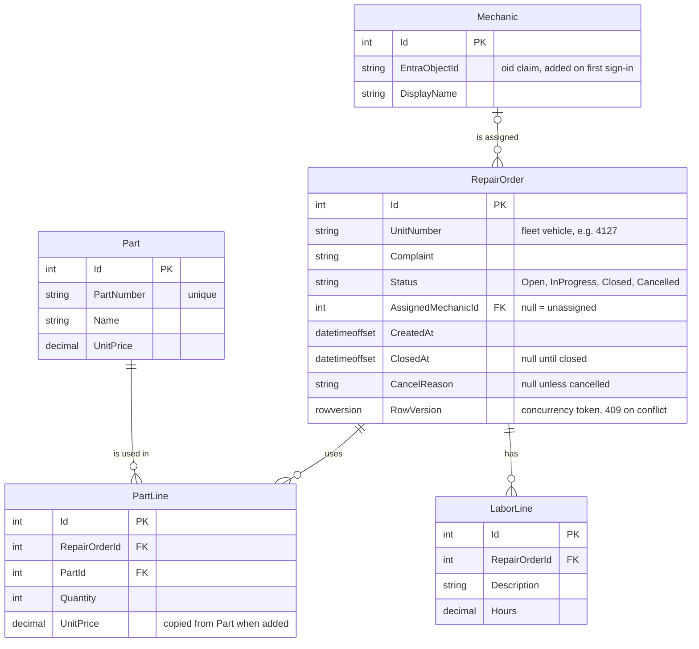
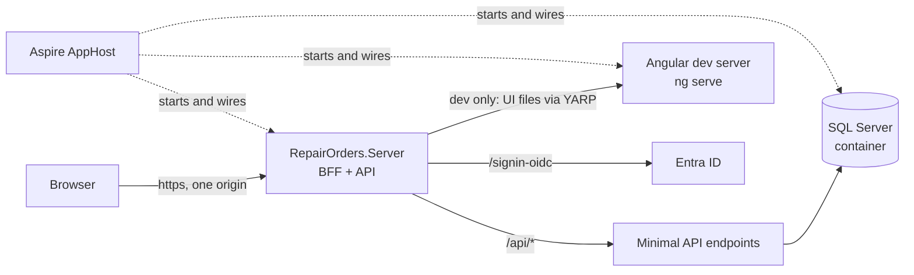
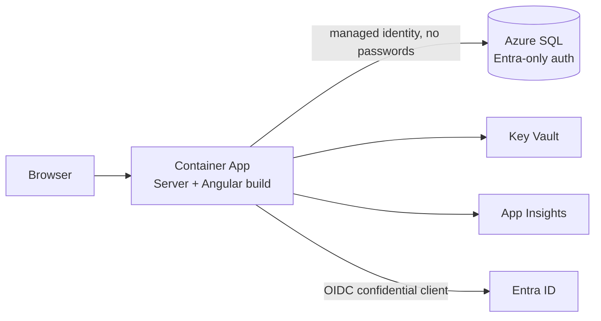
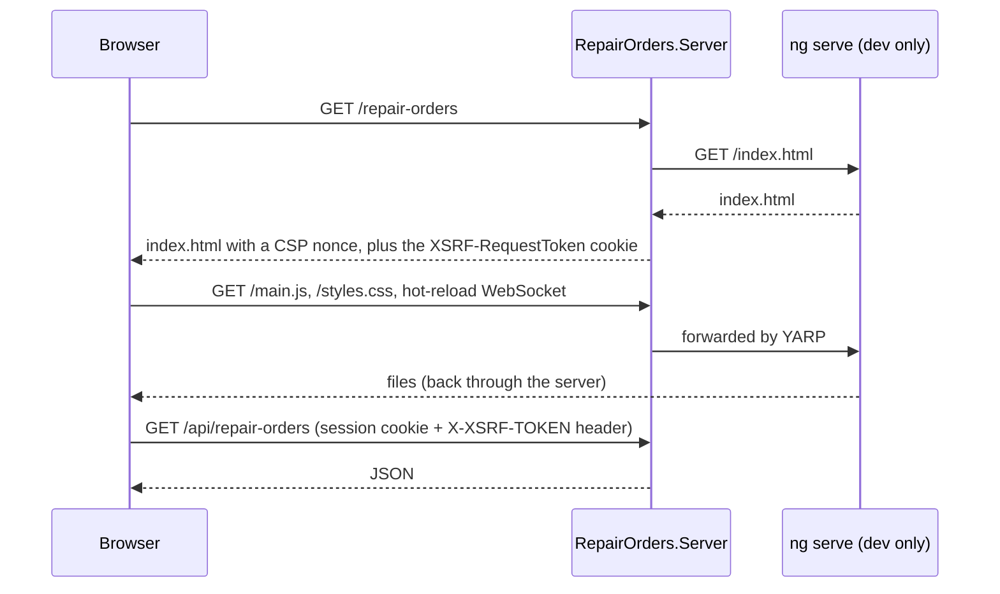
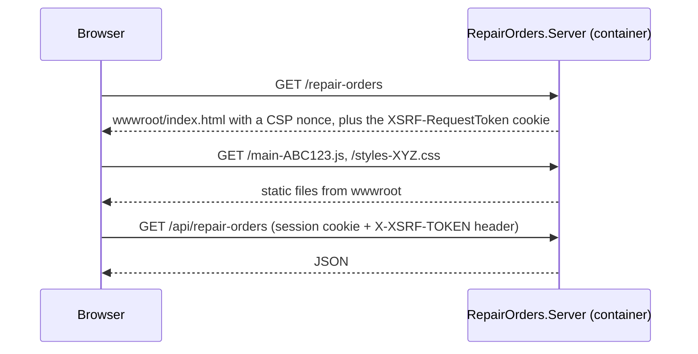
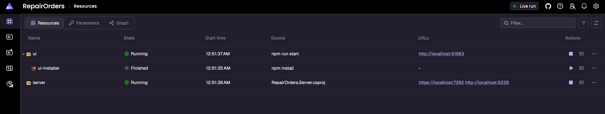
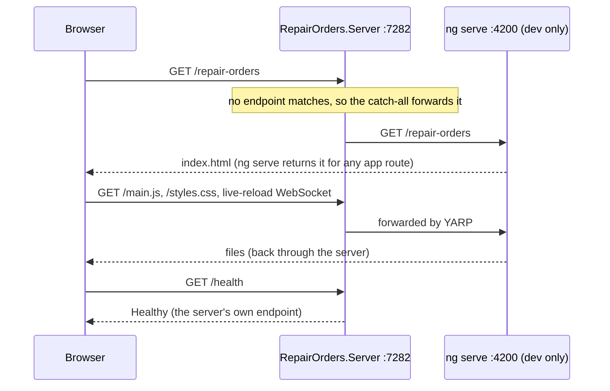
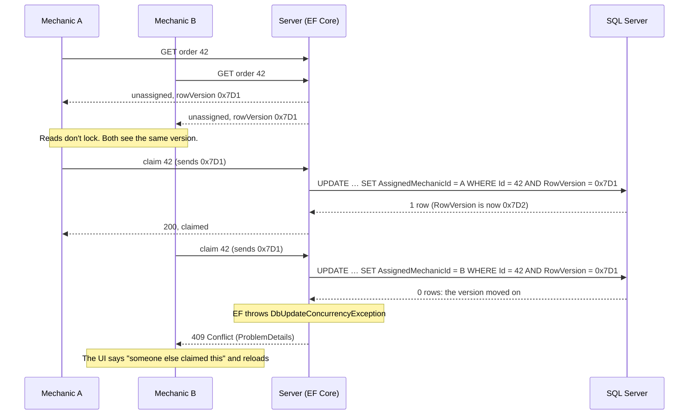
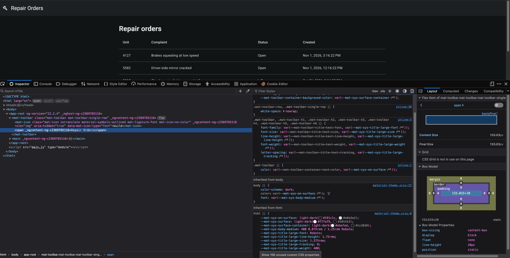
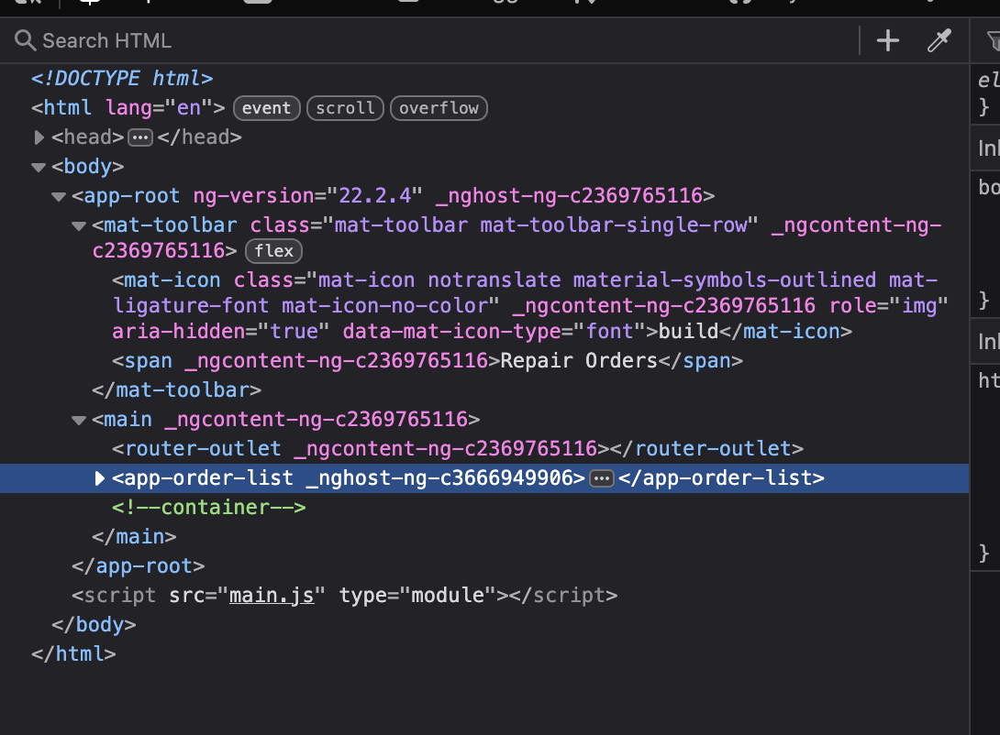

# bff-aspnetcore-angular
**Repair Orders**: a full-stack app for mechanics, built with Angular and ASP.NET Core using the Backend for Frontend (BFF) pattern. EF Core and SQL Server for data, Aspire for local dev, and Bicep + GitHub Actions to deploy to Azure.

I'm building it step by step to show how an enterprise .NET + Angular app fits together, from the browser to the database to the cloud.

## Helpful links
1. [damienbod/bff-aspnetcore-angular](https://github.com/damienbod/bff-aspnetcore-angular): the BFF security setup I follow (Angular 22, .NET 10)
2. [Aspire with JavaScript sample](https://aspire.dev/reference/samples/aspire-with-javascript/) ([code](https://github.com/microsoft/aspire-samples/tree/main/samples/aspire-with-javascript)): how to run Angular from an Aspire AppHost
3. [Aspire JavaScript integration](https://aspire.dev/integrations/frameworks/javascript/)
4. [Microsoft.Identity.Web](https://learn.microsoft.com/entra/msal/dotnet/microsoft-identity-web/)
5. [Angular docs](https://angular.dev/) · [Angular Material](https://material.angular.dev/)
6. [Azure Verified Modules (Bicep)](https://azure.github.io/Azure-Verified-Modules/indexes/bicep/)

## How the app works
A truck comes into a fleet shop: "Unit 4127, brakes squealing." A mechanic opens a **repair order**, or picks an unassigned one from the list and **claims** it. While working, they add **parts** (searching the parts catalog) and **labor lines** (what they did, how long), then **close** the order. A supervisor keeps the shop moving: **reassigns** work and **cancels** orders a customer called off.

**Who can do what** (Entra app roles → authorization policies):

| | Mechanic | Supervisor |
|---|---|---|
| See all orders, create an order | ✅ | ✅ |
| Claim an unassigned order | ✅ | ✅ |
| Add parts and labor, close the order | Only orders assigned to them | Any order |
| Reassign an order to another mechanic | | ✅ |
| Cancel an order (with a reason) | | ✅ |
| Manage the parts catalog | | Seeded data for now, no screen |

Orders are never deleted. A repair order is a business record (parts used, hours billed), so "the customer changed their mind" is a **Cancelled** status with a reason, and the history stays. A closed or cancelled order is read-only.

**The data model** (where it ends up; I add tables as features need them, each with its own migration):

- `PartLine.UnitPrice` is a copy, so a later price change in the catalog doesn't rewrite what an old order cost.
- `Mechanic` only maps a signed-in Entra user to a row the orders can point at. Entra stays the source of truth for who people are and their roles.

| Feature | What it shows |
|---|---|
| Order list (`/repair-orders`) | Material table with server-side paging and sorting, a status filter kept in the URL, `RepairOrderStore` with signals, loading and error states |
| New order page (`/repair-orders/new`) | A typed form, validation in the UI **and** the API, ProblemDetails errors on the right fields, an unsaved-changes guard |
| Order details (`/repair-orders/:id`) | A route parameter, a page component with presentational children, a `computed` parts total |
| Claim an order | Two mechanics claim the same order at once: the second gets **409** from the **rowversion** check |
| Add a part (dialog) | Autocomplete: `debounceTime` + `switchMap` → `GET /api/parts?search=…`, turned into a signal with `toSignal` |
| Add a labor line | A small inline form |
| Close an order | A business rule (at least one labor line), then read-only |
| Sign in with Entra ID | The BFF: cookie session, anti-forgery, role-based route guards in Angular, policies and a resource check ("is this order assigned to me?") on the server. Angular never holds a token |

### Local dev
The ASP.NET Core server is the **only front door**. The browser always talks to one origin, so the auth cookie just works and there's no CORS. In dev, the server forwards UI requests to the Angular dev server with YARP, so hot reload still works. Aspire starts everything.



### In Azure
One container serves both the Angular build (from `wwwroot`) and the API.



### How Angular and ASP.NET Core run together, in dev and in production
In dev, Angular runs on its own dev server (`ng serve`) for hot reload. In production there's no dev server, just built files. There are three common ways to wire that up:

| Setup | Dev: what the browser hits | Production | Used by |
|---|---|---|---|
| **Angular dev server in front** | `ng serve`; its `proxy.conf.js` forwards `/api` to ASP.NET Core | ASP.NET Core serves the built files from `wwwroot` | Microsoft's [Angular and ASP.NET Core](https://learn.microsoft.com/visualstudio/javascript/tutorial-asp-net-core-with-angular) Visual Studio template |
| **Separate front end** | Same as above | Angular in its own nginx container that proxies `/api` to the API | Aspire's [aspire-with-javascript](https://github.com/microsoft/aspire-samples/tree/main/samples/aspire-with-javascript) sample |
| **Server in front (BFF)** ✅ | ASP.NET Core; it forwards UI requests to `ng serve` with [YARP](https://learn.microsoft.com/aspnet/core/fundamentals/servers/yarp/yarp-overview) | ASP.NET Core serves the built files from `wwwroot` | [damienbod's BFF sample](https://github.com/damienbod/bff-aspnetcore-angular), and this app |

I use the third one. In a BFF the server owns the session: the sign-in redirect to `/signin-oidc`, the session cookie, the anti-forgery cookie, the security headers and the CSP nonce in `index.html`. If `ng serve` were the front door in dev, none of that would run the way it does in production, and security bugs would only show up after a deploy. With the server in front, dev and production have the same front door and only the source of the UI files changes. The cost is a few YARP routes that exist only in dev.

**In dev, once auth is in (roadmap 3).** The server fetches `index.html` from `ng serve` and adds the security bits. YARP forwards the JS, CSS and hot-reload traffic. The browser only ever talks to the server, so everything stays on one origin.



**In production.** `ng build` writes static files that end up in the server's `wwwroot`. There's no dev server and no YARP route. Deep links like `/repair-orders/42` still get `index.html`, so Angular's router takes over.



In damienbod's code, the `_Host` Razor page renders `index.html` in both modes, and `MapReverseProxy()` is only called inside `if (app.Environment.IsDevelopment())`. Until I add auth (roadmap 3), I start simpler: YARP forwards `index.html` too (see [4c](#4c-one-origin-with-yarp) for how it runs today), and production uses `MapFallbackToFile("index.html")`.

## Design decisions
| Decision | Why | What I didn't pick |
|---|---|---|
| **BFF:** the server signs the user in, keeps the tokens, and gives the browser an HttpOnly cookie | No tokens in the browser, so an XSS bug can't steal them. One security context for the whole app (see [Why BFF](#why-bff-and-not-msal-in-the-browser)) | MSAL Angular with tokens in the browser: common in Microsoft samples, but the tokens are readable by JavaScript |
| **The BFF and the API are the same app.** YARP only proxies the Angular dev server, in dev | This is how damienbod's sample works. Same origin, no extra hop, one thing to secure | A separate API behind the BFF, with YARP forwarding calls and attaching an access token. Worth it when several APIs or teams are involved |
| **App roles + authorization policies** for Mechanic and Supervisor | Roles are assigned in Entra ID and arrive in the `roles` claim; policies check them on each endpoint | API **scopes**: I don't need them, because the browser never calls an API with a token. Scopes come in when the server calls a downstream API (like Microsoft Graph) on the user's behalf |
| **Angular CLI** | Standard tooling. Nothing here needs a monorepo tool | Nx |
| **Angular Material + CDK**, with the order list as a Material table whose paging, sorting and filters (status, date range) run **on the server** | Free, made by the Angular team, accessible, has dialogs, tables and a date-range picker. Filtering belongs on the server anyway: a grid's built-in filters only see the rows it has loaded | **AG Grid Community** (free): worth it for spreadsheet-like features (column filters, grouping, pinning) that this app doesn't need. **Syncfusion / Kendo / DevExtreme**: paid suites (Syncfusion's community license is free for individuals), a large dependency and their own way of doing everything |
| **Plain CSS** for components, plus **one Sass file** for the Material theme | Modern CSS has nesting and variables, and components style themselves with Material's `--mat-sys-*` CSS variables. The theme is the one place Sass earns its keep: `mat.theme` turns two palettes into every color token, light or dark. `ng add @angular/material` creates that file | All-SCSS components: nothing in them needs Sass. A prebuilt theme CSS file: only four color choices. Tailwind: a second styling system next to Material |
| **TypeScript types generated from the API's OpenAPI document** ([`openapi-typescript`](https://openapi-ts.dev/)), called from my own small `HttpClient` services | The C# DTOs stay the source of truth, and a renamed field breaks the Angular build instead of failing at runtime. Calls still go through Angular's `HttpClient`, so interceptors (anti-forgery header, 401 → sign in) and `httpResource` work | **Kiota**: Microsoft's generator, but its TypeScript client sends requests with `fetch`, not `HttpClient`, so Angular interceptors don't see them. **NSwag**: generates whole Angular services, but it's tied to its own OpenAPI pipeline, and a big generated service is harder to read than a small hand-written one |
| **No chart library** for the home page: today's orders by status as plain CSS bars | Five numbers are clearer as bars than as a pie (bar lengths are easy to compare, pie slices aren't), and they need no dependency | **AG Charts Community** (free, MIT, has an Angular package): my pick if the app later needs real charts, like orders per day over a month |
| **Signals for state, RxJS for streams;** a feature store provided on the route | The modern Angular default, and easy to read | NgRx: worth it when many features share complex state |
| **EF Core migrations, applied by a separate deploy step** (a [migration bundle](https://learn.microsoft.com/ef/core/managing-schemas/migrations/applying#bundles) built in CI, run before the new app version), never by the app at startup in production | EF Core's [own guidance](https://learn.microsoft.com/ef/core/managing-schemas/migrations/applying): the app runs with a login that can only read and write data, a separate deploy identity changes the schema, and a failed migration stops the release before the new code goes out | Migrating at app startup: simple, but every replica needs schema rights and a bad migration takes the app down. A reviewed **SQL script** (`--idempotent`): the right pick when a DBA must approve the SQL. **DbUp**: hand-written SQL scripts, good when the database isn't owned by EF |
| **Aspire** for local dev | One command starts the server, Angular and SQL, with a dashboard and traces | docker-compose plus scripts |
| **Bicep with Azure Verified Modules**, in an `infra/` folder with one `.bicepparam` file per environment | Infra is reviewed code, `what-if` previews changes, and Microsoft maintains the modules | Aspire-generated infra (a quick start, less control); Terraform |
| **The az CLI in the pipeline** (`az deployment group what-if` / `create`, then `az acr` and `az containerapp`), each step a plain command in a GitHub Actions job | This is the shape of Microsoft's own [IaC with GitHub Actions architecture](https://learn.microsoft.com/devops/deliver/iac-github-actions) and what most enterprise Bicep pipelines look like (in GitHub or Azure DevOps). Each stage is its own job, in an order I can explain: what-if → approval → infra → migration bundle → app, with the *same* image promoted from dev to prod. The commands run the same way in my terminal, so a failed step is easy to reproduce. See [az CLI or azd?](#az-cli-or-azd-for-the-pipeline) | **azd**: a good, supported tool in CI too (it has `azd provision --preview` for what-if, and `azd publish` + `azd deploy --from-package` for build once, deploy many). But it's built for developers who own the whole app: one `azure.yaml`, its own environment state in a gitignored `.azure/` folder, and for an Aspire app it generates the Bicep from the AppHost unless I override it. Its `azd pipeline config` is still Beta. **`azure/bicep-deploy`**: Microsoft's newer GitHub Action around the same what-if/create, a fine swap later. **`aspire deploy`**: deploys straight from the AppHost. It's Aspire's own recommendation, but its CI/CD docs don't cover what-if or migrations yet |
| **Azure Container Apps** | The same hosting as my order-processing app; one container | App Service: simpler for a single web app |
| **GitHub Actions:** dev deploys automatically, prod needs approval; sign-in with OIDC | How teams ship, with no stored secrets | Deploying from my laptop (`azd up` or `az deployment`): fine to try something in a throwaway resource group, but nobody can review it and it needs my rights on the subscription |

## Why BFF, and not MSAL in the browser
### The problem with tokens in the browser
With MSAL Angular, the Angular app signs the user in itself and keeps the access and refresh tokens in the browser. Any script that runs on my page can read them: an XSS bug, or a compromised npm package. The script can send the tokens anywhere and use them until they expire. A browser app also can't keep a secret, so it can only be a *public* client.

### What BFF changes
The server does the sign-in instead. It's a *confidential* client (it has a secret or certificate), runs the OpenID Connect code flow with Entra ID, keeps the tokens on the server, and gives the browser only a session cookie. The browser attaches that cookie to every request to the same origin, so Angular never touches a token. The IETF's [OAuth 2.0 for Browser-Based Applications](https://datatracker.ietf.org/doc/draft-ietf-oauth-browser-based-apps/) calls BFF the most secure option for browser apps.

Because the Angular app and the server are deployed together on one origin, the app has **one security context**: one sign-in, one session, no CORS, no tokens to forward. Keeping the architecture this simple makes security easier to get right, and it's much harder to add later than to start with.

**Trade-offs I'd mention:**
- XSS is still bad. An injected script can call my API *as me* while the page is open. What it can't do is steal a token and use it somewhere else later. So I still add a Content Security Policy and security headers, as damienbod's sample does.
- The server now holds sessions and tokens. With more than one instance, the token cache has to be shared (a distributed cache) instead of in memory.

### How XSS could happen in this app, and what stops it
XSS means the attacker's JavaScript runs on *my* page, in *someone else's* browser. Here's how it could happen in this app.

1. A mechanic's account is stolen (a lost tablet that's still signed in). The attacker types this into an order's complaint field: `Brakes squealing `
2. The server saves it. It's just text.
3. A supervisor opens that order. **If** the page turns the text into HTML, the browser runs the `onerror` code as the supervisor.
4. The script calls my API from the supervisor's own page, so it has the supervisor's cookie *and* can read the anti-forgery token. It can reassign or cancel orders, or read every order and send the data to the attacker's server.

The stolen tablet on its own isn't XSS. That attacker can already do what a mechanic can, and the answers are authorization (a mechanic only changes their own orders), short sessions, and Entra (MFA, revoking sessions). XSS is worse: it **borrows a more powerful user's session**. HttpOnly doesn't stop step 4. It only stops the script from copying the cookie and using it somewhere else later.

**What would make step 3 happen** (in Angular, you have to opt into all of these):
- Binding user text with `[innerHTML]`, especially with `DomSanitizer.bypassSecurityTrustHtml(...)` ("we wanted bold text in notes")
- Writing to the DOM directly (`ElementRef.nativeElement.innerHTML = ...`) or through a third-party library that does
- Building HTML on the server by pasting user input into it (the future `index.html` step must only add a nonce, never user data)
- A compromised npm package or third-party script: then the attacker's code ships *inside* my bundle and needs no input at all

**What stops it, in layers:**
1. **Encode on output, not on input.** Angular escapes everything in `{{ }}` and property bindings by default, so the complaint above shows up as text. I never use `bypassSecurityTrust*` on user data. Encoding on *input* (saving `&lt;img&gt;`) is the wrong fix: the data is wrong everywhere else it's used (reports, exports, the API), and it gets double-encoded on display.
2. **Validate on input** as a second layer: max lengths, required fields and allowed values on the server. It limits what can be stored, but it doesn't replace output encoding.
3. **Content Security Policy** with a per-request nonce (roadmap 3, like damienbod's sample). Even if markup gets injected, the browser refuses to run scripts that don't carry the nonce, including inline `onerror` handlers.
4. **Dependency hygiene:** a committed lock file, `npm ci` in CI, `npm audit`, no scripts from CDNs.
5. **Least privilege:** the server checks every action (role and "is this order assigned to me?"), so a hijacked session can only do what that user could already do.

Sources: Angular's [security guide](https://angular.dev/best-practices/security) and OWASP's [XSS prevention cheat sheet](https://cheatsheetseries.owasp.org/cheatsheets/Cross_Site_Scripting_Prevention_Cheat_Sheet.html).

### How the session cookie is protected
| Attribute | What it does |
|---|---|
| `HttpOnly` | JavaScript can't read the cookie (`document.cookie` doesn't show it). The browser still sends it. |
| `Secure` | Sent only over HTTPS. |
| `SameSite=Lax` | Not sent on cross-site POSTs, iframes or `fetch` calls. It *is* sent when I follow a link to the app from another site, so I stay signed in. ASP.NET Core's default for the auth cookie. |
| `SameSite=Strict` | Never sent on a request that starts on another site, not even a link. Safer, but the first page after clicking a link looks signed out. |
| `__Host-` name prefix | The browser only accepts the cookie if it's `Secure`, has `Path=/` and no `Domain`, so a subdomain can't set or overwrite it. damienbod uses it for the anti-forgery cookie. |

One exception: Entra ID returns the user to `/signin-oidc` with a cross-site POST, so the short-lived correlation and nonce cookies ASP.NET Core uses during sign-in are `SameSite=None`. The session cookie isn't.

### Anti-forgery on top of SameSite
SameSite isn't enough on its own. It works per *site*, not per origin, so a sibling subdomain counts as same-site, and `Lax` still allows cross-site GET navigations (so a GET must never change data). damienbod's sample adds an anti-forgery token: the server puts it in a readable cookie, an Angular interceptor copies it into an `X-XSRF-TOKEN` header on every API call, and the server rejects POST/PUT/DELETE requests without a valid one. Another site can't read my cookies, so it can't set that header.

### One session, step by step
| What happens | Result |
|---|---|
| I sign in at `https://myapp` | The server sets the session cookie: `HttpOnly; Secure; SameSite=Lax` |
| Angular calls `GET /api/repair-orders` | The browser attaches the cookie; the server reads it and knows who I am. Angular's code never sees it |
| Something requests `http://myapp` | `Secure`: the cookie isn't sent over plain HTTP, and the server redirects to HTTPS |
| An injected script on my page reads `document.cookie` | `HttpOnly`: the session cookie isn't there |
| `evil.example` auto-submits a form that POSTs to `https://myapp/api/repair-orders/42/close` | `SameSite=Lax`: no cookie, so 401. Even if the cookie were sent, there's no `X-XSRF-TOKEN` header, so 400 |
| I click a link to the app in an email | `Lax`: the cookie is sent and I'm still signed in |

Note: a script on *another* site can never read my cookies; the browser's same-origin policy already stops that. `HttpOnly` is about scripts running on *my* page.

### Where I learned this
1. [End-to-end security in a web application](https://youtu.be/6cdV-oN_Yao) (talk)
2. [Implement a secure web application using Angular and an ASP.NET Core server](https://damienbod.com/2023/09/11/implement-a-secure-web-application-using-nx-standalone-angular-and-an-asp-net-core-server/) (damienbod)
3. [damienbod/bff-aspnetcore-angular](https://github.com/damienbod/bff-aspnetcore-angular)
4. [Azure-Samples: ASP.NET Core web app with OpenID Connect](https://github.com/Azure-Samples/active-directory-aspnetcore-webapp-openidconnect-v2)
5. [MDN: Set-Cookie](https://developer.mozilla.org/docs/Web/HTTP/Reference/Headers/Set-Cookie) and [ASP.NET Core anti-forgery](https://learn.microsoft.com/aspnet/core/security/anti-request-forgery)

## az CLI or azd for the pipeline
I wanted the industry-standard way, not just what's quickest, so I checked what Microsoft says before picking.

**What "best practice" means here** comes from the [Well-Architected Framework](https://learn.microsoft.com/azure/well-architected/operational-excellence/safe-deployments), not from a tool:
- All infra is code.
- Every environment is deployed only by an automated pipeline.
- Changes are small, and each one is previewed and reviewed before it ships.
- The same build artifact is promoted from dev to prod.
- The pipeline signs in with OIDC, with no stored secrets.

All three tools can do this. The difference is how much each one hides.

| | az CLI + Bicep | azd | `aspire deploy` |
|---|---|---|---|
| Who it's for ([Microsoft's comparison](https://learn.microsoft.com/azure/developer/azure-developer-cli/azure-developer-cli-vs-azure-cli)) | DevOps engineers, admins, any pipeline | Developers who own the whole app ("opinionated, high-level commands") | Aspire apps, driven by the AppHost |
| Preview changes | `az deployment group what-if` | `azd provision --preview` | Not covered in the [CI/CD docs](https://aspire.dev/deployment/ci-cd/) |
| Build once, deploy to dev then prod | Push an image tag, deploy that tag | [`azd publish` + `azd deploy --from-package`](https://learn.microsoft.com/azure/developer/azure-developer-cli/publishing-workflows) | `aspire publish`, then apply later |
| CI setup | Write the workflow myself | `azd pipeline config` (Beta) creates the OIDC credential and a workflow | Write the workflow myself |
| Where its state lives | Nothing local; Azure is the state | A gitignored `.azure/<env>/.env`, which has to be rebuilt on every runner | Aspire's deployment state cache |
| Infra for this app | My Bicep with AVM | My Bicep, or Bicep generated from the AppHost | Generated from the AppHost |

**My pick: the az CLI**, in GitHub Actions jobs I write myself:
1. It's the shape of Microsoft's [IaC with GitHub Actions architecture](https://learn.microsoft.com/devops/deliver/iac-github-actions) (PR → what-if → merge → approved deploy) and of most enterprise Bicep pipelines. The same commands work in Azure DevOps.
2. I can see and explain every stage, and I need a separate migration-bundle step between infra and app anyway. With azd that step would be a hook inside `azd provision` or `azd deploy`.
3. It keeps my hand-written AVM Bicep as the only infra definition.

azd isn't second-rate. For a small team that owns one app end to end, `azd up` plus `azd pipeline config` is Microsoft's fastest supported path, and it now has a preview and build once, deploy many. I'd pick it for a greenfield app where no platform team reviews infra changes. In an interview I'd say: *"azd and `aspire deploy` are great for getting an app running. For governed infra with what-if and approval gates I use the az CLI directly, because every step is explicit and the same pattern works on any CI system."*

## Angular conventions
I follow Angular's own [style guide](https://angular.dev/style-guide) and its [best practices for AI-assisted code](https://angular.dev/ai/develop-with-ai). In short:
- **Files:** hyphenated names (`order-list.ts`), one concept per file, tests next to the code (`order-list.spec.ts`), folders by feature, not by type (`components/`, `services/`). Feature folders sit straight under `src/app/` (`repair-orders/`, later `home/`), with no `features/` wrapper: the [style guide's example](https://angular.dev/style-guide#organize-your-project-by-feature-areas) does the same, and when every folder is a feature, the wrapper adds a level that says nothing. A folder gets subfolders only when it grows too big to scan.
- **Components:** standalone (no NgModules, no `standalone: true`), `input()` / `output()` / `model()` instead of decorators, `computed()` for derived state, `host: {}` instead of `@HostBinding`.
- **State:** signals; `set()` / `update()`, never mutate.
- **Templates:** `@if` / `@for` / `@switch`; `[class.x]` and `[style.x]` instead of `ngClass` / `ngStyle`; complex logic moves into a `computed()`.
- **Members:** `inject()` instead of constructor injection; `protected` for what only the template reads; `readonly` for inputs, outputs and queries.
- **Routes:** lazy-loaded per feature.
- **Creating files:** components with the CLI (`npx ng generate component repair-orders/order-list --flat`), so every component gets the same four files (`.ts`, `.html`, `.css`, `.spec.ts`), the `app-` selector prefix and the current conventions. `--flat` puts them straight into the feature folder instead of a folder per component. Plain TypeScript files (types, small helpers) I write by hand; `ng generate interface` would only create an empty `export interface`.
- **Accessibility:** WCAG AA and AXE checks pass.

## Roadmap
1. **Local skeleton:** Aspire AppHost, the server, SQL Server, and the Angular app behind YARP. `GET /api/repair-orders` and a simple order list page with Angular Material. No auth yet.
2. **Deploy the skeleton early**, before the features, so every later schema change and new Azure resource ships the way it would at work:
   - **Infra as code:** Bicep with Azure Verified Modules, `dev` and `prod` parameter files.
   - **Pull request workflow:** build, test, `bicep lint`, and `what-if` against dev and prod. The what-if output goes into the run's summary and a PR comment, so a reviewer sees exactly which Azure resources would be created, changed or deleted before merging.
   - **Main workflow:** build the container image and the EF migration bundle once → dev (infra, migrations, app) → **pauses for approval** on the GitHub `prod` environment (required reviewer), with prod's what-if in the summary → prod (infra, migrations, app).
   - **No clickops and no stored secrets:** the pipeline signs in to Azure with OIDC (federated credentials). People get Reader on prod; only the pipeline changes it.
   - **Two database identities:** the pipeline's identity runs migrations (schema rights). The app's managed identity can only read and write data.
3. **BFF auth:** Entra ID sign-in, cookie, anti-forgery, Mechanic and Supervisor app roles.
   Then, to learn **scopes**: show the signed-in user's profile from Microsoft Graph (the server gets a token for `User.Read` on the user's behalf).
4. **The repair-order features, one migration each:** a home page with today's orders by status (a `GROUP BY` summary endpoint, drawn with plain CSS bars, no chart library), list filters (status, date range) and paging on the server, new order page, details page, claim (409 check), parts dialog with autocomplete, labor lines, close, reassign and cancel, a signal store, ProblemDetails.
5. **Tests:** API integration tests (xUnit + Aspire testing), Angular component tests, added to the pipeline.
6. *Maybe:* split the API into its own service behind the BFF with YARP, to learn token forwarding.

## Local setup
What I have: .NET SDK 10.0.400, Aspire CLI 13.6, Azure CLI 2.90, azd 1.35, Docker Desktop.

### Install Node
Angular 22 needs Node 24 (LTS). I use [mise](https://mise.jdx.dev/) instead of nvm. The Node version is pinned in a `mise.toml` checked into the repo, so anyone who clones the repo (and CI) gets the same version. One tool also covers other languages, not just Node.

I install it with Homebrew, like the rest of my tools, so `brew upgrade` keeps it current:
```bash
brew install mise
```
`mise -v` then suggests swapping to its own `curl https://mise.run | sh` installer because it's a bit faster. I skipped that: it's milliseconds per command, and it would mean a second updater and an extra PATH entry.

Then I put mise's shims on PATH (from mise's [shims guide](https://mise.jdx.dev/dev-tools/shims.html)). Shims are small stand-ins for `node` and `npm` that pick the version from the nearest `mise.toml` each time they run, so they work in my terminal and in apps like Rider and Aspire. macOS Terminal opens login shells, which read `~/.bash_profile`. I append one line to the end of it. It has to come after the existing `brew shellenv` line, which is what puts `mise` on PATH:
```bash
echo 'eval "$(mise activate bash --shims)"' >> ~/.bash_profile   # >> appends; > would overwrite the file
tail -3 ~/.bash_profile                                          # check it's the last line
source ~/.bash_profile                                           # load it into this terminal (new terminals do it themselves)
```
mise also has a second line, `eval "$(mise activate bash)"`, that hooks the prompt to load `[env]` vars from `mise.toml`. I don't use `[env]`, so the shims line is all I need.

Then pin Node for this repo:
```bash
cd ~/RiderProjects/bff-aspnetcore-angular
mise use node@24        # installs Node 24 and writes mise.toml
node -v && npm -v
```
`node -v` prints `v24.22.2`, and the new `mise.toml` is just:
```toml
[tools]
node = "24"
```
I also set Node 24 as my global default. I found this out the hard way: `aspire agent init` (step 3) runs `npm` in a temp folder, and with no global version mise's shim failed with `No version is set for shim: npm`. The repo still pins its own version:
```bash
mise use -g node@24     # writes ~/.config/mise/config.toml
```
mise then warns that `node is defined in .../mise.toml which overrides the global config`. That's expected: inside this repo the repo's pin wins, and everywhere else the global one applies.

Later (4d-3) mise also pins the EF Core command-line tool, so `mise.toml` is the one place for dev tool versions. The .NET SDK itself I installed from [Microsoft's installer](https://dotnet.microsoft.com/download) before this repo existed, and I kept it that way: mise can install SDKs too, but Rider, C# Dev Kit and Aspire all find the SDK in its standard location (`/usr/local/share/dotnet`) with no setup. The .NET way to pin an SDK version for a repo is a `global.json`, which works however the SDK was installed.

### Azure CLI and Bicep
I installed the Azure CLI with Homebrew (`brew install azure-cli`). Before upgrading Bicep I checked where my copy came from, because Bicep can be installed several ways (Homebrew, a standalone download, the az CLI):
```bash
cd ~
which bicep                          # nothing: no standalone Bicep on PATH
ls -la ~/.azure/bin                  # bicep: the copy the az CLI downloaded for itself
az config get bicep                  # use_binary_from_path = false
```
So there's one Bicep CLI, the one `az` manages in `~/.azure/bin`, and `use_binary_from_path = false` tells `az` to use that copy even if another `bicep` shows up on PATH later. That makes `az bicep upgrade` the right way to update it. The VS Code Bicep extension brings its own language server for the editor, so it doesn't matter which CLI I have. In CI the az CLI fetches Bicep the same way.
```bash
cd ~
az bicep upgrade && az bicep version
```
It went from 0.47.16 to 0.48.1, installed in the same `~/.azure/bin/bicep`.

### Machine setup lives in each repo, kept short
I first installed the Azure CLI and Bicep while preparing [rag-on-dotnet](https://github.com/akhanalcs/rag-on-dotnet#local-dev-setup). I thought about moving all machine setup (.NET, Azure, Bicep, Docker) into one repo and linking to it from the others, but I didn't: a reader of *this* repo should see what it needs without jumping to another one, and a shared page goes stale for the repos that don't match it anymore. So each README lists only what that repo needs, with the version and a link to the official install page. The detailed "why" stays here. If I want to rebuild a laptop in one go, the standard tool is a [Homebrew `Brewfile`](https://docs.brew.sh/Brew-Bundle-and-Brewfile) (`brew bundle dump` writes one) in a personal dotfiles repo. That's a later, optional TODO.

### Start Docker
Aspire runs SQL Server in a container, so Docker has to be running.
```bash
open -a Docker
```

### Clone the reference samples
I keep official samples next to my repos and copy patterns from them instead of guessing.
```bash
mkdir -p ~/RiderProjects/_refs && cd ~/RiderProjects/_refs
git clone --depth 1 https://github.com/damienbod/bff-aspnetcore-angular damienbod-bff
git clone --depth 1 https://github.com/microsoft/aspire-samples
```
- `damienbod-bff/server/Program.cs`: Microsoft.Identity.Web sign-in, anti-forgery (`X-XSRF-TOKEN`), security headers, and YARP to the Angular dev server
- `aspire-samples/samples/aspire-with-javascript`: Angular in an AppHost with `AddJavaScriptApp(...).WithHttpEndpoint(env: "PORT")`

**For the infra step (roadmap 2)** I looked for "gold" Bicep and pipeline code. The best sources are official, but none of them is a single sample:

| Source | What I take from it | Why not more |
|---|---|---|
| Learn docs: [Deploy Bicep with GitHub Actions](https://learn.microsoft.com/azure/azure-resource-manager/bicep/deploy-github-actions), [OIDC from GitHub to Azure](https://learn.microsoft.com/azure/developer/github/connect-from-azure-openid-connect), [what-if](https://learn.microsoft.com/azure/azure-resource-manager/bicep/deploy-what-if), [deployment stacks](https://learn.microsoft.com/azure/azure-resource-manager/bicep/deployment-stacks); GitHub: [environments with required reviewers](https://docs.github.com/actions/deployment/targeting-different-environments/using-environments-for-deployment) | The pipeline, one piece at a time: sign-in with a federated credential, what-if, the approval gate, deploy. From the quickstart I take the OIDC part (the federated credential, `permissions: id-token: write`, `azure/login@v2`), not its one push-to-deploy job. | Microsoft's old *Bicep and GitHub Actions* learning path (the one the quickstart still links) is retired: its URLs redirect to the Resource Manager landing page. So there's no single course; I put the pieces together from these pages. |
| [Azure Verified Modules](https://azure.github.io/Azure-Verified-Modules/) | The Bicep. Each module (SQL server, Container Apps, Key Vault) has a README with usage examples and secure defaults, and Microsoft maintains and versions it. | Nothing to clone. The Bicep MCP server's `list_avm_metadata` tool finds the module and its latest version. AVM's [AI-assisted solution development](https://azure.github.io/Azure-Verified-Modules/usage/ai-assisted-sol-dev/) page is an overview of letting Copilot pick AVM modules and generate the code (it leads into Spec Kit, a spec-first workflow). It has no setup steps. I already get the useful part, current module metadata, from the Bicep MCP server, and I write the Bicep myself. |
| [Azure-Samples/bicep-github-actions](https://github.com/Azure-Samples/bicep-github-actions) | The **branch → PR (lint + what-if) → merge → approved deploy** flow. [Learn's architecture article](https://learn.microsoft.com/devops/deliver/iac-github-actions) shows the same diagram, and I borrow the idea of writing the what-if output to the run summary and a PR comment. | Its last commit was in 2022. It has one `main.bicep` with no app and pins old action versions (`azure/login@v1`), so I take the diagram and the idea, not the YAML. |
| azd templates such as [FBoucher/AspireAzStorage](https://github.com/FBoucher/AspireAzStorage) and [azure-ai-travel-agents](https://github.com/Azure-Samples/azure-ai-travel-agents) | Nothing for this step. | Both deploy with `azd up` or `azd provision`/`azd deploy`. Neither runs a what-if or waits for an approval. AspireAzStorage writes raw resources instead of AVM and has no workflows. The travel-agents sample uses AVM, but it's a large multi-language Node and AI app. Good for a demo, not for change control at work. |

## Build it step by step
The Angular app is its own Angular CLI workspace, next to the .NET projects, not inside one. It only calls relative `/api/*` URLs, so it doesn't know or care what backend serves it, and it would work the same behind a Java or Python BFF. The two only meet at publish time, when the Angular build output is copied into the server's `wwwroot`. damienbod's sample uses the same split (`ui/` and `server/`).

```
RepairOrders.slnx
mise.toml                          # pins Node 24
src/
  RepairOrders.AppHost/            # Aspire: starts everything in dev
  RepairOrders.ServiceDefaults/    # OpenTelemetry, health checks, resilience
  RepairOrders.Server/             # BFF + API; serves the Angular build in production
  ui/                              # Angular CLI workspace (ng serve, ng build, npm)
tests/                             # later: integration and component tests
infra/                             # later: Bicep
```
The `.slnx` sits at the root, not in `src/`, like Microsoft's [eShop](https://github.com/dotnet/eShop). It covers `src/` and `tests/`, and repo-wide files like `global.json` and `Directory.Build.props` sit next to it and apply to everything below.

### 1. Create the solution
- **AppHost:** starts and wires everything locally.
- **ServiceDefaults:** OpenTelemetry, health checks and HTTP resilience, shared by every service.
- **Server:** the BFF and the API. It starts from the empty `web` template, so there's no code I didn't write.

Why not one `aspire new` command? None of the templates fits. `aspire-starter` adds a Blazor front end and a weather API I'd only delete. In Aspire 13.6, `aspire-empty` creates a single-file AppHost (`apphost.cs`) with no ServiceDefaults. `dotnet new aspire` makes a `.sln` with the projects at the root instead of in `src/`. So I run one template per project. It's a few more lines, but each one is a choice I can explain, and the project-based AppHost is what eShop and the Aspire samples use.

```bash
cd ~/RiderProjects/bff-aspnetcore-angular
dotnet new update                       # latest template patches (Aspire 13.6.0 → 13.6.4)
dotnet new sln -n RepairOrders          # .NET 10 creates RepairOrders.slnx
dotnet new aspire-apphost -n RepairOrders.AppHost -o src/RepairOrders.AppHost
dotnet new aspire-servicedefaults -n RepairOrders.ServiceDefaults -o src/RepairOrders.ServiceDefaults
dotnet new web -n RepairOrders.Server -o src/RepairOrders.Server
dotnet sln add src/RepairOrders.AppHost src/RepairOrders.ServiceDefaults src/RepairOrders.Server
dotnet add src/RepairOrders.AppHost reference src/RepairOrders.Server
dotnet add src/RepairOrders.Server reference src/RepairOrders.ServiceDefaults
dotnet build
```
What I got: `RepairOrders.slnx` at the root with the three projects in a `/src/` solution folder, an AppHost on `Aspire.AppHost.Sdk/13.6.4` whose `AppHost.cs` is still empty, and a Server whose `Program.cs` is just `MapGet("/", () => "Hello World!")`.

### 2. Create the Angular app
`npx` runs the latest Angular CLI (22.2.5 when I did this) without installing it globally. New Angular apps are standalone and zoneless by default, and use Vitest for tests.
```bash
cd src
npx @angular/cli@latest new ui --style=css --routing --ssr=false --skip-git --ai-config=claude-code --interactive=false
cd ui && npx ng version
```
- `--style=css`: plain CSS, the CLI's default. Modern CSS has nesting and variables, so I don't need Sass (see the design decisions).
- `--ssr=false`: the ASP.NET Core server serves the app, so there's no Node server to render pages.
- `--skip-git`: the repo already has git; this stops the CLI from making a second repo inside `src/ui`.
- `--ai-config=claude-code`: adds Angular's own best-practices rules file for Claude Code (the `angular-new-app` skill recommends it).
- `--interactive=false`: no prompts, so the command is the whole record of what I chose.

`npx` is npm's package runner: inside `src/ui`, `npx ng` runs the CLI from the project's `node_modules/.bin`, so I always use the version pinned in `package.json`. Outside a project, `npx @angular/cli@latest` downloads the package to npm's cache and runs it once.

What I got: Angular 22.2 with CLI 22.2.5, TypeScript 6.0 and Vitest 5.

### 3. Editor and AI tooling
**Editor.** In VS Code I install the [Angular Language Service](https://angular.dev/tools/language-service) (`angular.ng-template`), which gives completions and type errors inside templates. The CLI's `src/ui/.vscode/extensions.json` already recommends it. Rider has Angular support built in.

**AI tooling.** I write the code, but I use Claude Code as a pair programmer. To keep its advice on each team's current guidance instead of its training data, I give it the official skills and MCP servers.

**Skills vs. MCP servers.** Two different things, and I use both:
- A **skill** is a folder with a `SKILL.md`: written instructions for one kind of task (how Angular wants components written, how to wire an AppHost, "check a .NET API exists before using it"). Claude sees each skill's one-line description all the time and reads the full instructions only when a task matches, so they cost few tokens.
- An **MCP server** is a program that offers *tools*. When Claude decides to call a tool, Claude Code sends the request to the server, and the server's answer (a doc page, a code sample) goes into Claude's context. It runs either on my machine (`"command"`, like the Angular CLI, which needs to read my workspace) or remotely (`"type": "http"`, like Microsoft Learn, which Microsoft hosts). The transport doesn't change the token cost; the tool results do.

That's why Microsoft Learn shows up twice: the **MCP server** in `.mcp.json` gives Claude the tools (`microsoft_docs_search`, `microsoft_docs_fetch`, `microsoft_code_sample_search`), and the **skills** from the `microsoftdocs/mcp` repo tell it when and how to use them, such as checking a method really exists before writing it. `npx skills add` only copies `SKILL.md` files; it never touches `.mcp.json`.

| What | From | How I added it |
|---|---|---|
| Angular skills | [Angular team](https://angular.dev/ai/agent-skills) | `npx skills add https://github.com/angular/skills -a claude-code`: `angular-developer`, `angular-new-app` |
| Angular rules | Angular CLI | `src/ui/CLAUDE.md`, created by `ng new --ai-config=claude-code` |
| Angular CLI MCP server | [Angular CLI](https://angular.dev/ai/mcp) | `.mcp.json`, created by `ng new`, moved to the repo root |
| Aspire skills | [Aspire team](https://aspire.dev/get-started/aspire-skills/) | `aspire agent init --non-interactive --skills all --skill-locations claudecode` |
| Microsoft Learn MCP server | [Microsoft](https://learn.microsoft.com/training/support/mcp) | Added to `.mcp.json` by hand (below) |
| Microsoft Learn skills | [Microsoft](https://github.com/MicrosoftDocs/mcp) | `npx skills add microsoftdocs/mcp -a claude-code`: `microsoft-docs`, `microsoft-code-reference` |
| .NET skills | [.NET team](https://github.com/dotnet/skills) | `npx skills add dotnet/skills -a claude-code`: `dotnet-webapi`, `optimizing-ef-core-queries` |
| Bicep MCP server | [Bicep team](https://learn.microsoft.com/azure/azure-resource-manager/bicep/bicep-mcp-server) | Added to `.mcp.json` at the infra step: `dnx -y Azure.Bicep.McpServer` |
| Later | | Test skills at the testing step |

**For Bicep I add only the Bicep MCP server.** Its tools are the ones that keep generated Bicep honest: `get_bicep_best_practices`, `list_avm_metadata` (which AVM module and version), `get_az_resource_type_schema` (the real properties for an API version) and `get_bicep_file_diagnostics` (compile errors without a deploy). The VS Code Bicep extension (0.40.2+) also installs it, but only for Copilot. Claude Code needs its own entry in `.mcp.json`. `dnx` ships with the .NET 10 SDK and runs the latest NuGet package on demand, so there's nothing to install.

**What `dnx` is.** The .NET version of `npx`: [`dnx <package>`](https://learn.microsoft.com/dotnet/core/tools/dotnet-tool-exec) (short for `dotnet tool exec`) downloads a .NET *tool* package from NuGet into the NuGet cache (`~/.nuget/packages`) and runs it. It isn't added to any project or to PATH. `-y` skips the "download this package?" prompt, which matters here because Claude Code starts the server in the background where nobody can answer it. With no version it runs the latest, which suits an AI helper; `Azure.Bicep.McpServer@0.48.1` would pin it. NuGet has two kinds of packages, and they install differently:
- **Libraries** (EF Core, Aspire integrations) are always per project, a `<PackageReference>` in a `.csproj`. They're downloaded once into `~/.nuget/packages` and shared by every project that uses that version. There's no "global library".
- **Tools** (`dotnet-ef`, the Bicep MCP server) are command-line apps. They can be global (`dotnet tool install -g`, into `~/.dotnet/tools`), per repo (a `.config/dotnet-tools.json` manifest), pinned by mise (how I pin `dotnet-ef`), or run on demand with `dnx`.

I skipped Microsoft's [Azure Skills plugin](https://github.com/microsoft/azure-skills) (`azure-prepare`, `azure-deploy` and others, plus the Azure MCP server). Its skills are built to generate infra and *run* deployments for you, mostly through azd. I want to write the Bicep myself and have only the pipeline deploy, with the az CLI. The [Learn agent skills](https://learn.microsoft.com/training/support/agent-skills) are docs links I already get through the Learn MCP server.

For every `npx skills add` I picked **Project** scope. The skills are copied into `.claude/skills/`, and `skills-lock.json` records each one's source and hash. Both are committed, so anyone who clones the repo gets the same guidance. The `dotnet/skills` repo offers 110 skills (Blazor, MAUI, MSBuild and more); I took only the ones this app uses.

`aspire agent init` added `aspire` (a router that picks the others), `aspire-init`, `aspireify` (wiring the AppHost), `aspire-orchestration` (start/stop), `aspire-monitoring` (logs and traces), `aspire-deployment`, `aspire-project-v2-migration`, `dotnet-inspect` (looks up .NET package APIs) and `playwright-cli` (drives a real browser to check the UI). It also installs the Playwright CLI through npm and writes `.playwright/cli.config.json` (use Chromium). It doesn't add the Aspire MCP server; that's opt-in with `--mcp`, and I left it out. [Aspire's docs](https://aspire.dev/get-started/aspire-skills/) say skills don't need it, and the `aspire-monitoring` skill already gets resource state, logs and traces from the CLI (`aspire describe`, `aspire otel logs`). An MCP server that does the same thing would only add its tool descriptions to every session.

My `.mcp.json` at the repo root:
```json
{
  "mcpServers": {
    "angular-cli": {
      "command": "npx",
      "args": ["-y", "@angular/cli", "mcp", "--read-only"]
    },
    "microsoft-learn": {
      "type": "http",
      "url": "https://learn.microsoft.com/api/mcp"
    },
    "bicep": {
      "command": "dnx",
      "args": ["-y", "Azure.Bicep.McpServer"]
    }
  }
}
```
I added the `bicep` entry by hand at the infra step (see the note on `dnx` above).

What each server gives Claude:
- **Angular CLI** (`npx @angular/cli mcp`) runs on my machine because it reads my workspace. It finds the projects in `angular.json` and the installed Angular version, then answers *for that version*: `get_best_practices`, `search_documentation` (angular.dev), `ai_tutor`, plus migration helpers such as `onpush_zoneless_migration`. `--read-only` turns off the tools that change files or run commands.
- **Microsoft Learn** is a server Microsoft hosts. Claude Code, the MCP client, sends tool calls to `https://learn.microsoft.com/api/mcp` over HTTP and gets back doc excerpts, full pages or code samples. Claude never browses the site itself.

**Picking up a new server.** Claude Code reads `.mcp.json` when a session starts, so after editing it I start a new session (in VS Code: Developer: Reload Window), approve the new server, and check `/mcp`. The **Start** button VS Code shows above each server in `.mcp.json` comes from VS Code's own MCP support. It starts the server for Copilot Chat, not for Claude Code.

**Check they're working.** I don't run this in the terminal. I type `/mcp` in the Claude Code chat. It lists each server from `.mcp.json` as connected or failed, and I can open one to see its tools. Then I test each one for real by asking Claude to "list the Angular projects in this repo", which should call `list_projects` and find `ui` in `src/ui`, and to "search Microsoft Learn for Aspire AddJavaScriptApp". When I first open a repo with a new `.mcp.json`, Claude Code asks me to approve its servers. After that it doesn't ask again, so not being asked doesn't mean they're broken.


The two under **Project** come from this repo's `.mcp.json`. The others come with my claude.ai account, not this repo.

**Bumps along the way**, in case I set this up again:
- `ng new` wrote `.mcp.json` into `src/ui`, because it assumes the Angular workspace is the repo root. Claude Code only reads `.mcp.json` from the folder it starts in, so I moved it (`mv src/ui/.mcp.json .`). It's editor config, so moving it doesn't change the app. I also added `--read-only`, since I write the code.
- `aspire agent init` first failed to install Playwright with `No version is set for shim: npm`. It runs npm in a temp folder, and mise had no global Node. Fixed with `mise use -g node@24` (see Install Node), then re-ran it.
- `/mcp` showed `angular-cli` as failed: `npx` not found. VS Code reads my shell environment once, when it starts, and I'd added the mise line to `~/.bash_profile` after that. Quitting VS Code fully (Cmd+Q, not just closing the window) and reopening fixed it.
- `aspire agent init` adds a telemetry hook to `~/.claude/settings.json` that reports which Aspire skills get used. I opted out with `export ASPIRE_CLI_TELEMETRY_OPTOUT=true` in `~/.bash_profile`. That's about privacy, not tokens: the hook's output never reaches Claude's context.
- I first tried Claude Code **plugins** (`/plugin install ...`) for the .NET and Learn pieces, but `/plugin` isn't available in the VS Code extension. Installing the skills with `npx skills` and the MCP server through `.mcp.json` gets the same thing, works in both VS Code and the CLI, and lives in the repo instead of my user profile.
- I first installed `configure-auth` from `dotnet/skills`, but it's for **Blazor** auth, not a BFF with Angular, so I removed it (`npx skills remove configure-auth`). For Microsoft.Identity.Web I rely on the Learn skills.
- The skills installer also offers a global `find-skills` skill; I don't need it.

### 4. Run it with Aspire
I wire things up one piece at a time and run after each one: the server (4a), the Angular app (4b), YARP so both share one origin (4c), SQL Server and the first API (4d), then the order list in Angular (4e).

#### 4a. The server under Aspire
The pattern comes from [`aspire-with-javascript`](https://github.com/microsoft/aspire-samples/tree/main/samples/aspire-with-javascript) in `microsoft/aspire-samples`: the AppHost registers the API with `AddProject`, and the API calls `AddServiceDefaults()`.

[`AppHost.cs`](src/RepairOrders.AppHost/AppHost.cs) registers the server with `AddProject`:
- `Projects.RepairOrders_Server` is a type the Aspire SDK generates from the AppHost's `<ProjectReference>`. The `.` in the name becomes `_`.
- `WithExternalHttpEndpoints()` **changes nothing locally**; on my machine every endpoint is reachable on `localhost` anyway. It matters at deploy time. Aspire marks the endpoint as external, so in Azure Container Apps the server gets [external ingress](https://learn.microsoft.com/azure/container-apps/ingress-overview#external-and-internal-ingress): a public URL. Without it, the app gets internal ingress, reachable only by other apps in the same Container Apps environment. The server is the only thing a browser talks to, so it's the only resource that gets this. SQL Server and, later, a separate API stay internal.
- `WithHttpHealthCheck("/health")` makes Aspire poll the server's `/health` endpoint. The dashboard shows real health instead of just "process started", and later `WaitFor(server)` waits until the server is actually ready.

[`Program.cs`](src/RepairOrders.Server/Program.cs) adds `builder.AddServiceDefaults()` (OpenTelemetry, health checks, service discovery, HttpClient resilience) and `app.MapDefaultEndpoints()` (maps `/health` and `/alive`, in Development only).

**Running it.** Either of these:
- **Terminal:** `aspire run` from the repo root. It stays in the foreground, prints the dashboard link with a login token, and Ctrl+C stops everything. `aspire start` does the same in the background, and `aspire stop` ends it.
- **VS Code:** with the [Aspire extension](https://aspire.dev/get-started/aspire-vscode-extension/) installed, open `AppHost.cs` and click **Run Aspire AppHost** (or **Debug Aspire AppHost**) in the editor title bar, next to the usual Run button. Debug attaches the C# debugger to the server, so breakpoints work. The Aspire view in the sidebar lists the resources; right-click one to restart it or see its logs.

Both run the same AppHost. I use the extension: **Aspire** view in the sidebar → **Run AppHost**.

What I got: the dashboard at `https://localhost:17010` with `server` **Running** and **Healthy**, `Hello World!` on the server's URL, and the server's logs and traces in the dashboard.

**Bumps:**
- **Firefox said "Be careful. Something doesn't look right" (`MOZILLA_PKIX_ERROR_SELF_SIGNED_CERT`).** The dashboard uses the ASP.NET Core dev certificate. `dotnet dev-certs https --trust` trusts it in the macOS keychain, which Safari and Chrome use, but Firefox keeps its own certificate store. Firefox's `security.enterprise_roots.enabled` was already `true` and didn't help: it imports certificate *authorities* from the keychain, and the dev certificate is a self-signed leaf, not a CA. So I checked that the certificate Firefox showed was mine (`CN=localhost`, same SHA-1 fingerprint as `dotnet dev-certs https --check --trust`) and clicked **Advanced → Proceed to localhost:17010 (Risky)**. Firefox remembers that exception for `localhost:17010`. It's safe because localhost traffic never leaves my machine.

#### 4b. The Angular app under Aspire
```bash
cd ~/RiderProjects/bff-aspnetcore-angular
aspire add javascript      # adds Aspire.Hosting.JavaScript 13.6.4 to the AppHost
```
`Aspire.Hosting.JavaScript` is a **hosting integration**: a NuGet package that teaches the AppHost a new kind of resource. The core AppHost only knows .NET projects, containers and plain executables. This package adds `AddJavaScriptApp`, which knows how to run `npm install` and `npm run <script>`. Only the AppHost uses it; it doesn't ship with the app.

In [`AppHost.cs`](src/RepairOrders.AppHost/AppHost.cs), `ui` is an `AddJavaScriptApp("ui", "../ui", runScriptName: "start")`:
- `runScriptName: "start"` → `npm run start` → `"start": "ng serve"` in `src/ui/package.json`.
- `WithNpm()` runs `npm install` in `src/ui` before each start, as its own resource (`ui-installer` in the dashboard). It installs the app's packages into `node_modules`, not npm itself (mise provides Node and npm). It's quick when nothing changed, and a fresh clone runs without extra setup.
- `WithHttpEndpoint(targetPort: 4200)` tells Aspire the app listens on 4200, `ng serve`'s default. That gives `ui` a URL in the dashboard and a name (`ui`) the server can look up. Aspire puts its own proxy in front, so the URL shows a different port, which forwards to 4200.
- No `WithExternalHttpEndpoints()`: the dev server is never deployed. In production the Angular build is served from the server's `wwwroot`.

**Why a fixed port.** The `aspire-with-javascript` sample lets Aspire pick the port and passes it in (`"start": "ng serve --port $PORT"`). I tried that first, but `ng serve` doesn't read a `PORT` variable, so it needed either a shell-specific npm script or an extra `WithArgs` line in the AppHost. Port 4200 needs neither. The cost: 4200 must be free (`ng serve` fails loudly if it isn't), and I can't run two copies at once. For one developer, that's fine.

**Run order of the description.** Code in `AppHost.cs` only *describes* resources. Nothing starts until `builder.Build().Run()`, and then Aspire starts everything at once.

What I got: `ui-installer` **Finished**, then `ui` **Running**, with the Angular welcome page on its URL. The server still answers on its own URL. They're two separate origins until 4c.

#### 4c. One origin with YARP
The browser should only ever talk to the server. So in dev the server answers what it owns (`/health`, later `/api/*` and sign-in) and forwards everything else to `ng serve` with [YARP direct forwarding](https://learn.microsoft.com/aspnet/core/fundamentals/servers/yarp/direct-forwarding).

```bash
cd ~/RiderProjects/bff-aspnetcore-angular
dotnet add src/RepairOrders.Server package Microsoft.Extensions.ServiceDiscovery.Yarp --version 10.10.0
```
This is the glue package between Aspire service discovery and YARP. It depends on `Yarp.ReverseProxy` (2.3.0), so YARP comes with it, and it adds `AddHttpForwarderWithServiceDiscovery()`, a YARP forwarder that resolves `http://ui` to wherever Aspire is running the `ui` resource. I pinned 10.10.0 to match `Microsoft.Extensions.ServiceDiscovery` in ServiceDefaults.

- **AppHost:** `ui` is now declared before `server`, and the server gets `.WithReference(ui)`. That hands the server `ui`'s address as config (`services:ui:http:0`), which service discovery reads.
- **Server:** `builder.Services.AddHttpForwarderWithServiceDiscovery()` and, inside `if (app.Environment.IsDevelopment())`, `app.MapForwarder("/{**catch-all}", "http://ui")`. A catch-all route has the lowest priority in ASP.NET Core routing, so real endpoints like `/health` still win. This is the same idea as Microsoft's [Blazor + Entra BFF sample with YARP and Aspire](https://learn.microsoft.com/aspnet/core/blazor/security/blazor-web-app-with-entra?pivots=with-yarp-and-aspire), which forwards to `https://weatherapi` by resource name. damienbod lists about ten Angular dev routes (`@vite`, `@ng`, `*.js`, …) because a Razor page owns everything else; with one catch-all I don't need them.
- I removed the template's `MapGet("/", () => "Hello World!")`, or `/` would never reach Angular.



What the dashboard shows: Aspire started `ui` by running `npm run start` (which runs `ng serve`), after its child resource `ui-installer` ran `npm install` and finished. `server` is the .NET project. Its URL, `https://localhost:7282`, now shows the Angular app: the server forwards those requests to `ng serve` through Aspire's proxy for `ui` (port 51563 here, which forwards to 4200).

How it runs today (no auth yet):

`/repair-orders` is an **Angular** route (a page), not an API call. `ng serve` returns `index.html` for every path that isn't a file, and Angular's router reads the URL in the browser and shows the right page. API calls use their own prefix, `/api/repair-orders`, so the two never collide.

What I got: the Angular page on the server's URL, `/health` answered by the server, and editing `app.html` live-reloads the page on `:7282`, so the live-reload WebSocket goes through YARP too.

**A trap to fix next:** `curl https://localhost:7282/api/repair-orders` returns `index.html` with `200`, because there's no API yet and the catch-all forwards it. A typo in an API path would look like success to the Angular `HttpClient`. In 4d I map `/api/*` so unknown API paths return `404`.

#### 4d. SQL Server, EF Core and the first API
Four small steps, running the app after each: the database container (4d-1), the EF Core model (4d-2), the first migration and seed data (4d-3), then `GET /api/repair-orders` and the `/api/*` 404 (4d-4). The AppHost wiring follows [`database-migrations`](https://github.com/microsoft/aspire-samples/tree/main/samples/database-migrations) in `microsoft/aspire-samples`.

**4d-1. SQL Server in the AppHost**
```bash
cd ~/RiderProjects/bff-aspnetcore-angular
aspire add sqlserver      # adds Aspire.Hosting.SqlServer 13.6.4 to the AppHost
```
Another hosting integration, like `javascript` in 4b. It adds `AddSqlServer` (a SQL Server **container**) and `AddDatabase`. In [`AppHost.cs`](src/RepairOrders.AppHost/AppHost.cs):
- `AddSqlServer("sql")` with `WithLifetime(ContainerLifetime.Persistent)` and `WithDataVolume()`: the container keeps running between AppHost runs, and the data lives in a Docker volume.
- `AddDatabase("repairorders", databaseName: "repairorders")`: the first argument is the **resource name**, which is also the **connection string name** (`ConnectionStrings:repairorders`). `databaseName` is the real database inside SQL Server. It defaults to the resource name; I wrote it out so the two jobs are visible.
- The server gets `.WithReference(db).WaitFor(db)`: the connection string, and no start until the database exists.
- Aspire generates the `sa` password and saves it in the AppHost's user secrets (`Parameters:sql-password`), along with the host port (`Resources:sql:tcp:port`). Both stay the same across runs, which a persistent container needs. Nothing secret is in the repo.

What I got: the first run pulled the image (~1.5 GB). The image is amd64-only, and it runs fine under Rosetta on my Apple Silicon Mac. `sql` and `repairorders` reached **Running**, then `server` started. The one "Login failed ... Failed to open the explicitly specified database 'repairorders'" line in the `sql` log is expected: Aspire checked for the database, didn't find it, and then logged "Creating database 'repairorders'".

**Looking inside the database.** The app doesn't need this, but it's handy for checking migrations and data. I use the [SQL Server (mssql) extension for VS Code](https://learn.microsoft.com/sql/tools/visual-studio-code-extensions/mssql/mssql-extension-visual-studio-code):
1. Install it from the Extensions view (search "SQL Server (mssql)", publisher Microsoft).
2. Get the port and password from the AppHost's user secrets (`Resources:sql:tcp:port` and `Parameters:sql-password`). The easiest way: in the Solution Explorer (C# Dev Kit), right-click `RepairOrders.AppHost` → **Manage User Secrets**, which opens its `secrets.json`:
   ```json
   {
     "Resources:sql:tcp:port": "20657",
     "Parameters:sql-password": "<generated>",
     ...
   }
   ```
   Or from a terminal:
   ```bash
   cd ~/RiderProjects/bff-aspnetcore-angular
   dotnet user-secrets list --project src/RepairOrders.AppHost
   ```
3. In the SQL Server view → **Add Connection**, with Input type **Parameters**:

   | Field | Value | Why |
   |---|---|---|
   | Profile Name | `repairorders (Aspire)` | Any label |
   | Server name / Port | `localhost` / the `Resources:sql:tcp:port` value | Docker maps that host port to 1433 in the container |
   | Trust server certificate | ✅ | The container's certificate is self-signed |
   | Authentication type | SQL Login | The container has no Entra ID; `sa` is SQL Server's built-in admin |
   | User name / Password | `sa` / the `Parameters:sql-password` value | Generated by Aspire |
   | Database name | `repairorders` | Appears in the list once the login works |
   | Encrypt | Mandatory (default) | Works because the certificate is trusted |

   Then **Test connection** → **Connect**. If you skip the trust box, you get "error occurred during the pre-login handshake ... error: 35": the TLS handshake failed because the extension doesn't trust the self-signed certificate. Click **Enable 'Trust Server Certificate'** and it connects.
4. **Querying:** in the **SQL Server** view, expand the connection → `repairorders` → Tables, right-click `dbo.RepairOrders` → **Select Top 1000** (it writes and runs the query), or right-click the database → **New Query** to write my own and press **Run** in the editor's toolbar.

The extension also adds a **Database Projects** view. That's not for browsing data: it's for SQL database projects (`.sqlproj`), where the schema is kept as `CREATE TABLE` scripts and deployed as a DACPAC. It's the other way to own a schema in the Microsoft world (common with DBA teams). I use EF Core migrations instead, so I don't need it. This is a local `sa` login; in Azure the app uses Entra-only auth to Azure SQL, with no passwords.

**4d-2. The EF Core model**
```bash
cd ~/RiderProjects/bff-aspnetcore-angular
dotnet add src/RepairOrders.Server package Aspire.Microsoft.EntityFrameworkCore.SqlServer --version 13.6.4
dotnet add src/RepairOrders.Server package System.Security.Cryptography.Pkcs --version 10.0.14
```
`Aspire.Microsoft.EntityFrameworkCore.SqlServer` is the **client integration**, the app-side partner of `Aspire.Hosting.SqlServer`. It brings EF Core's SQL Server provider, and one call, `AddSqlServerDbContext`, does what I'd otherwise wire up by hand with the plain provider package:
- reads the connection string `ConnectionStrings:repairorders` (from the AppHost's `WithReference`)
- registers the `DbContext` with pooling
- retries brief SQL errors (`EnableRetryOnFailure`)
- adds a database check to `/health`
- sends EF Core's traces and metrics to the dashboard through OpenTelemetry

The retries are EF Core's own SQL retry strategy, not the HttpClient resilience from ServiceDefaults (that one only covers outgoing HTTP calls). With the plain `Microsoft.EntityFrameworkCore.SqlServer` package I'd wire up each of these myself.

The second package is a **security pin for a transitive dependency**. A *transitive* dependency is a package I never asked for: one of my packages depends on it. Here `Aspire.Microsoft.EntityFrameworkCore.SqlServer` asks for `System.Security.Cryptography.Pkcs` 10.0.12 (and `Microsoft.Data.SqlClient` 7.0.2 underneath it asks for an older one, which NuGet raises to 10.0.12). The build warned (NU1902/NU1903) that 10.0.12 has a high-severity denial-of-service bug, fixed in 10.0.13. I can't edit those packages' dependencies, but NuGet lets a **direct** reference win: if my project references a package itself, that version is used instead of the one a dependency asks for (["direct dependency wins"](https://learn.microsoft.com/nuget/concepts/dependency-resolution#direct-dependency-wins)). A NuGet dependency version is a minimum ("10.0.12 or later"), so 10.0.14 satisfies everyone.
- **Finding the chain:** `dotnet nuget why` answers "why is *this* package in my project?", so I pass the suspicious package (the bottom of the chain), not the one I added:
  ```bash
  cd ~/RiderProjects/bff-aspnetcore-angular
  dotnet nuget why src/RepairOrders.Server System.Security.Cryptography.Pkcs
  ```
  ```
  ├── Aspire.Microsoft.EntityFrameworkCore.SqlServer (v13.6.4)
  │   ├── Microsoft.Data.SqlClient (v7.0.2)
  │   │   └── System.Security.Cryptography.Pkcs (v10.0.14)
  │   ├── Microsoft.EntityFrameworkCore.SqlServer (v10.0.12)
  │   │   └── Microsoft.Data.SqlClient (v7.0.2)
  │   │       └── System.Security.Cryptography.Pkcs (v10.0.14)
  │   └── System.Security.Cryptography.Pkcs (v10.0.14)
  └── System.Security.Cryptography.Pkcs (v10.0.14)      ← my pin
  ```
  Pkcs arrives by three paths, and after the pin every one of them shows 10.0.14 (before, they showed 10.0.12). That's how I know the pin took effect.
- The pin has a comment in the `.csproj`. Once Aspire ships a SqlClient that brings a fixed version, I remove it.
- Interview version: "NuGet audit flagged a transitive package; I traced it with `nuget why`, pinned the patched version as a direct reference, and noted when to remove the pin."

What I wrote, in [`Data/`](src/RepairOrders.Server/Data/):
- [`RepairOrder`](src/RepairOrders.Server/Data/RepairOrder.cs): the entity (unit number, complaint, status, created date, row version) and the `RepairOrderStatus` enum. Only what the order list needs; the rest of [the data model](#how-the-app-works) arrives with its feature.
- [`RepairOrdersDbContext`](src/RepairOrders.Server/Data/RepairOrdersDbContext.cs): the `RepairOrders` set, plus the column rules EF can't guess:
  - **Max lengths** on strings, so they aren't `nvarchar(max)`, which can't be indexed.
  - **Status stored as text** (`"InProgress"`), not as the enum's number. The table reads clearly, and if someone reorders the enum later, old rows still mean the same thing. With numbers, `1` could silently turn from InProgress into something else.
  - **`RowVersion` as a SQL Server `rowversion`:** the database bumps it on every update, and EF puts it in the `UPDATE`'s `WHERE`. If someone else saved first, zero rows match and EF throws, which becomes a **409**. Optimistic concurrency without locks, enforced by the database. Example below.

**How rowversion handles two mechanics claiming order 42 at once** (the claim endpoint comes in roadmap 4):

Nobody is blocked from reading, and nothing is locked while a mechanic is looking at the screen. Only the second **write** loses, and it's told so instead of silently overwriting A's claim ("last write wins"). The alternative, pessimistic locking, would hold a database lock for as long as someone has the page open, which doesn't work for a web app.
- [`Program.cs`](src/RepairOrders.Server/Program.cs) registers it with `AddSqlServerDbContext<RepairOrdersDbContext>("repairorders")`.

Entities never leave the server. The API returns DTOs (4d-4), so the database shape and the API contract can change separately.

What I got: a clean build, and `server` still **Healthy**, now with the database check behind `/health`. No tables yet; the first migration creates them.

**4d-3. Migrations, the tool and the first table**

```bash
cd ~/RiderProjects/bff-aspnetcore-angular
mise use dotnet:dotnet-ef@10.0.12      # the dotnet ef CLI, pinned in mise.toml
dotnet add src/RepairOrders.Server package Microsoft.EntityFrameworkCore.Design --version 10.0.12
```
- **`dotnet-ef` through mise:** mise's [`dotnet:` backend](https://mise.jdx.dev/lang/dotnet.html) runs `dotnet tool install` for me and pins the version next to Node, so `mise install` sets up a fresh machine (or CI) in one step. The usual .NET alternative is a tool manifest (`.config/dotnet-tools.json` + `dotnet tool restore`); it works, but it would be a second file pinning tools.
- **10.0.12 everywhere:** that's the EF Core version Aspire's package brings, so the tool, the Design package and the runtime match. When Aspire moves EF Core forward, I bump all three together.
- **`Microsoft.EntityFrameworkCore.Design`** is what `dotnet ef` loads into my project to read the model and write migration code. It only **creates** migrations; **applying** them (`Database.Migrate()`, and the bundle) comes from `Microsoft.EntityFrameworkCore.Relational`, which the SQL Server provider already brings. `dotnet add` marks it `PrivateAssets="all"` because the package says it's a development dependency; the [`.csproj`](src/RepairOrders.Server/RepairOrders.Server.csproj) comment explains what that does and doesn't mean.

**A connection string for the tools.** `dotnet ef` builds my app by running `Program.cs`, without the AppHost, so Aspire's connection string isn't there and EF fails with "No database provider has been configured" ([Aspire's docs](https://aspire.dev/integrations/databases/efcore/migrations/) call this out). The tools [run the app as `Development`](https://learn.microsoft.com/ef/core/managing-schemas/migrations/applying#environment-and-configuration) when no environment is set, and Development loads **user secrets**, so I put the local connection string in the server's user secrets:
```bash
cd ~/RiderProjects/bff-aspnetcore-angular
dotnet user-secrets init --project src/RepairOrders.Server     # adds a UserSecretsId to the .csproj
```
Then **Manage User Secrets** on `RepairOrders.Server` (or `dotnet user-secrets set`) with `ConnectionStrings:repairorders` = `Server=localhost,<port>;Database=repairorders;User ID=sa;Password='<sql-password>';TrustServerCertificate=true`, using the port and password from the AppHost's secrets. The quotes around the password keep a `;` in it from ending the value. At runtime this is never used: Aspire passes the server its connection string as an environment variable, and environment variables win over user secrets.

**The first migration:**
```bash
cd ~/RiderProjects/bff-aspnetcore-angular
dotnet ef migrations add InitialCreate --project src/RepairOrders.Server --output-dir Data/Migrations
dotnet ef database update --project src/RepairOrders.Server
```
- `migrations add` compares the model with the last migration's snapshot and writes C# into [`Data/Migrations/`](src/RepairOrders.Server/Data/Migrations/): the migration (`Up` creates the table, `Down` drops it) and `RepairOrdersDbContextModelSnapshot.cs`, EF's record of what the model looks like now. It doesn't touch the database.
- **I read every generated migration before applying it.** EF's docs insist on this, because a rename can come out as drop-and-add, which loses data. This one has `nvarchar(20)`, `nvarchar(500)`, `Status` as `nvarchar(20)` and `RowVersion` as `rowversion`, as configured.
- `database update` applies whatever isn't applied yet and records it in `__EFMigrationsHistory`. That table is how EF (and later the bundle) knows what's done, so running it twice does nothing the second time.

What I got: `RepairOrders` and `__EFMigrationsHistory` (one row, `..._InitialCreate`) in the SQL Server view.

**Can I delete a migration?** It depends on whether anyone else has it:

| Situation | What to do |
|---|---|
| Only on my machine, not applied | `dotnet ef migrations remove`: deletes the last migration **and** rolls the snapshot back. Never delete the files by hand; the snapshot would still describe the deleted change, and the next migration comes out wrong. |
| Applied to my local database, not pushed | `dotnet ef database update <PreviousMigration>` first (runs its `Down`), then `migrations remove`. Or drop the local database. |
| Pushed, merged, or deployed anywhere | **Don't.** Other databases have it in their history. Fix forward with a new migration that changes it back. |
| Hundreds of old migrations, slow builds | Some teams **squash**: replace them all with one new baseline migration and mark it applied in existing databases. Rare, planned, and done by the whole team at once. |

That's what people mean by "deleting migrations deep into development": it's either an unshared local mistake, or a planned squash. Deleting a deployed migration on its own breaks every other database.

**Catching a forgotten migration in CI.** If someone changes an entity but forgets `migrations add`, the code builds but the database doesn't match. EF Core 9+ has a command for exactly this; the pipeline (roadmap 2) runs it and fails the build:
```bash
dotnet ef migrations has-pending-model-changes --project src/RepairOrders.Server
```
EF Core 9+ also refuses to `Migrate()` when the model has changes no migration covers, so the mistake can't slip silently into production either.

**How this runs in production** (roadmap 2): not `dotnet ef database update`, and not the app at startup. The pipeline packs the same migrations into a [bundle](https://learn.microsoft.com/ef/core/managing-schemas/migrations/applying#bundles) and runs it as its own step, with an identity that has schema rights. The app's own login can only read and write data.

**4d-3b. Demo data, in Development only**

A fresh database should show a few orders. EF Core 9+ has a hook for this: [`UseSeeding` and `UseAsyncSeeding`](https://learn.microsoft.com/ef/core/modeling/data-seeding#use-seeding-method). EF calls it **after it applies migrations**, every time, even when there was nothing to apply. So seeding is just code, and it runs with the same command:
```bash
cd ~/RiderProjects/bff-aspnetcore-angular
dotnet ef database update --project src/RepairOrders.Server
```
- [`DevSeedData`](src/RepairOrders.Server/Data/DevSeedData.cs) adds one order in each status, only when the table is empty, so running it again changes nothing. It has a sync version (`dotnet ef database update` calls that one) and an async one (`MigrateAsync` calls that), because EF asks for both.
- [`Program.cs`](src/RepairOrders.Server/Program.cs) registers it through `AddSqlServerDbContext`'s `configureDbContextOptions` hook, **inside `if (builder.Environment.IsDevelopment())`**. `dotnet ef` runs the app as Development, so my local database gets the demo orders. The production bundle runs as Production, so production never does.

What I got: "No migrations were applied. The database is already up to date.", and then the seeding ran anyway: one `EXISTS` check, then a single `MERGE` inserting all 5 rows in one round trip, with `OUTPUT INSERTED.[Id], INSERTED.[RowVersion]` so EF learns the values SQL Server generated. The log also shows `sp_getapplock` on `__EFMigrationsLock`: EF 9+ takes a database-wide lock while migrating and seeding, so two runs at once can't both apply the same migration.

**Two kinds of seed data:**

| | Where | Reaches production? |
|---|---|---|
| **Reference data** every environment needs (the parts catalog, in roadmap 4) | `HasData` in the model. It becomes part of a migration, so it's reviewed like schema | Yes, through the bundle |
| **Demo or test data** | `UseSeeding` code, gated by environment | No |

**Why `DateTimeOffset.UtcNow`.** Every timestamp the server creates is in UTC. `DateTimeOffset.Now` wouldn't be *wrong*: on my laptop it gives `15:16+05:45` (Nepal), which is the same instant, and SQL Server compares `datetimeoffset` values by that instant. But the offset would only record where the server happened to run (my laptop, or UTC in Azure), so the data would have mixed offsets for no reason. UTC everywhere is the convention. The browser shows each time in the user's own time zone (Angular's `DatePipe` does that from the ISO string). Plain `DateTime.Now` is the one to avoid: it stores no offset at all, so nobody can tell later which time zone it meant.

**4d-4. The first API endpoint, and real 404s under `/api`**

- [`Api/RepairOrderEndpoints.cs`](src/RepairOrders.Server/Api/RepairOrderEndpoints.cs) maps `GET /api/repair-orders` in a route group. The query **projects** into a `RepairOrderListItem` DTO: SQL selects only those columns, EF doesn't track the results, and the entity never becomes the API contract. It's capped at 100 rows until the list gets real server-side paging. The handler returns `TypedResults.Ok<...>`, so OpenAPI can read the response type later, and takes a `CancellationToken`, so a closed browser tab cancels the SQL query.
- [`Program.cs`](src/RepairOrders.Server/Program.cs):
  - `ConfigureHttpJsonOptions` with `JsonStringEnumConverter`: the API sends `"InProgress"`, not `1`, the same as the database stores it.
  - `app.MapGroup("/api")` for the API, then `api.Map("/{**path}", ...)` returning **404** for any other `/api` path. ASP.NET Core picks the most specific route, and `/api/{**path}` starts with a literal segment, so it beats the Angular forwarder's `/{**catch-all}`. It's mapped outside the Development check because production's "everything else → `index.html`" fallback needs the same protection.
  - The file reads from most specific to least: health, the API, then "everything else goes to Angular". Routing doesn't depend on that order, but it's how routing decides, so it's the easiest way to read it.

What I got:
- `curl https://localhost:7282/api/repair-orders`: the 5 seeded orders as JSON, newest first, with `"status": "Open"` as text.
- `/api/repair-ordrs` (a typo): **404**. The trap from 4c is fixed.
- `/repair-orders`: **200**, still the Angular app.
- In the dashboard's **Traces**, the `GET /api/repair-orders` trace has the SQL query nested under the HTTP request, with its timing and SQL text.

#### 4e. The order list in Angular
**4e-1. Angular Material**
```bash
cd ~/RiderProjects/bff-aspnetcore-angular/src/ui
npx ng add @angular/material      # picked the Cyan/Orange palettes
```
`npx ng` runs the Angular CLI installed in this project, so it always matches the project's Angular version. `ng add` installs a package **and** runs its setup schematic, which is why it changed more than `package.json`:
- **`package.json`:** `@angular/material` and `@angular/cdk` (22.2.5).
  - **CDK** (Component Dev Kit) is the *behavior* without the look: overlays and positioning, focus trapping and other accessibility helpers, drag and drop, virtual scrolling, the base data table. **Material** is Google's Material Design *look* built on top of the CDK. Material depends on the CDK, so both get installed. When I need behavior with my own look (a custom dropdown, say), I use the CDK directly.
- **`src/material-theme.scss`:** the theme, a `mat.theme(...)` call that turns two color palettes into every `--mat-sys-*` CSS variable the components use. `mat.$cyan-palette` and `mat.$orange-palette` are Sass variables that come from `@use '@angular/material' as mat` (defined in `node_modules/@angular/material/core/theming/_palettes.scss`). There are twelve: red, green, blue, yellow, cyan, magenta, orange, chartreuse, spring-green, azure, violet and rose. Each is a set of tones from 0 (black) to 100 (white), and Material picks the right tones for light or dark mode.
  I kept Cyan/Orange and only switched `color-scheme` from `light` to `dark`. The theme defines every color with CSS `light-dark()`, so that one line flips the whole app to the dark palette. The [Crypgo](https://crypgo-nextjs-tailwind.vercel.app/) template's look (mint `$green-palette`, a navy `surface` override, DM Sans) is a five-line change to this file if I want it later.
- **`angular.json`:** adds the theme to the build's `styles` list, before `styles.css`.
- **`src/index.html`:** links two Google Fonts, Roboto (Material's default typeface) and Material Symbols (the icon font). What each line does:
  - **`<link rel="preconnect">`** tells the browser to open the connection (DNS lookup, TCP, TLS) to those servers right away, before it finds out it needs them. That saves a few hundred milliseconds on a cold load. There are two because Google Fonts uses two servers: `fonts.googleapis.com` serves the small CSS file with the `@font-face` rules, and `fonts.gstatic.com` serves the actual font files.
  - **`crossorigin`** on the gstatic one: browsers always fetch font files in CORS mode, and a preconnected connection is only reused for a request in the same mode. Without it, the early connection would be wasted.
  - **`display=swap`** in the Roboto URL: text shows straight away in a fallback font and swaps to Roboto when it arrives, instead of staying invisible.
  - **Material Symbols** is an icon font that uses ligatures: `<mat-icon>build</mat-icon>` is the word "build", and the font draws it as a wrench. `<mat-icon>` notices this stylesheet on the page and uses the `material-symbols-outlined` class by default.
  - In a production build the Angular CLI [inlines the Google Fonts CSS](https://angular.dev/reference/configs/workspace-config#fonts-optimization-options) into `index.html`, so that request disappears; the font files still come from gstatic.
  - These load from Google's servers. That matters when the Content Security Policy goes in (roadmap 3): it has to allow `fonts.googleapis.com` and `fonts.gstatic.com`, or I self-host the fonts. Self-hosting also means visitors' browsers don't contact Google, which some companies require for privacy.

**`angular.json` vs `package.json`.** They answer different questions:
- `package.json` is **npm's** file: *which packages, at which versions*, plus script shortcuts (`npm start` → `ng serve`). Every JavaScript project has one.
- `angular.json` is the **Angular CLI's** workspace file: *how to build, serve and test each project*: the entry file, which global styles and assets go in, production budgets and optimizations, the dev server's options.

In .NET terms, `package.json` is like the `<PackageReference>` list, and `angular.json` is like the build settings in a `.csproj` plus `launchSettings.json`.

**4e-2. A toolbar and the order list page**

How I got here: the component files came from the CLI, and I wrote the rest by hand.
```bash
cd ~/RiderProjects/bff-aspnetcore-angular/src/ui
npx ng generate component repair-orders/order-list --flat   # order-list .ts/.html/.css/.spec.ts
```
Then:
- [`repair-orders/repair-order.ts`](src/ui/src/app/repair-orders/repair-order.ts) (by hand): the shape of one row from the API. `RepairOrderStatus` is a **string literal union type**: a value must be one of those four strings, and the compiler checks every use. The closest thing in C# is an `enum`, but this one is made of the actual strings the API sends, and it disappears at compile time (JavaScript has no types). It's hand-written until roadmap 4 generates types from the API's OpenAPI document.
- [`repair-orders/order-list.ts`](src/ui/src/app/repair-orders/order-list.ts): `httpResource` loads `GET /api/repair-orders` when the page opens and exposes `value()`, `isLoading()` and `error()` as signals. No subscribe, no unsubscribe.
- [`order-list.html`](src/ui/src/app/repair-orders/order-list.html): a progress bar while loading, an error message if it fails, otherwise a Material table. The comments in the template explain the table's pieces (column definitions vs. row definitions).
- `DatePipe` turns the API's UTC timestamp into the viewer's local time (`Nov 1, 2026, 3:16:22 PM` here in Nepal). It's a *pure* pipe: Angular re-runs it only when the value it gets changes, so it isn't re-formatting every row on every change detection.
- [`app.routes.ts`](src/ui/src/app/app.routes.ts): `''` redirects to `repair-orders` until there's a home page. The route is **lazy-loaded**: the build puts the page in its own JS chunk (`order-list`, 12.5 kB compressed, separate from the 87 kB initial bundle), and the browser downloads it from the server the first time someone opens the page (from `ng serve` through YARP in dev; from the server's `wwwroot` in production). The component's `selector` (`app-order-list`) isn't used in any template, because the router creates the component itself; it's still the tag name of the element the router inserts next to `<router-outlet>`, which is what I see in DevTools.
- [`app.html`](src/ui/src/app/app.html) / [`app.ts`](src/ui/src/app/app.ts) / [`app.css`](src/ui/src/app/app.css): the shell. I replaced the CLI's placeholder (which ended in a bare `<router-outlet />`) with a `mat-toolbar` and `<main><router-outlet /></main>`. `<main>` is the page's main landmark, so screen readers can jump straight to the content, and it gives the routed pages one centered, padded column (`margin: 0 auto` splits the leftover width equally between left and right).
- `app.spec.ts`: the CLI's "should render title" test checked the placeholder's `<h1>`, so it now checks the toolbar instead.

What I got: the 5 orders in a dark Material table on `https://localhost:7282/repair-orders`. The browser calls `/api/repair-orders` on the **same origin** as the page, so there's no CORS setup and no API URL to configure. That's the payoff of 4c: one origin, with the server in front of everything.

**How Material's colors work (no magic)**

*The file format.* [`material-theme.scss`](src/ui/src/material-theme.scss) is **Sass** (SCSS syntax), not plain CSS: CSS plus variables, functions and **mixins**. A mixin is a reusable block of CSS that takes arguments; `@include mat.theme(...)` runs the `theme` mixin from `@use '@angular/material' as mat`, and the build turns the whole file into plain CSS. Cmd+click doesn't work on `mat.theme` because VS Code doesn't resolve Sass modules from `node_modules` (a Sass extension such as "Some Sass" adds that). The mixin is in `node_modules/@angular/material/core/tokens/_system.scss`; `node_modules/@angular/material/_index.scss` re-exports it as `mat.theme`.

*Tokens.* "Token" is a design-system word: a **named design decision**, like "the page background color" or "the title font size", stored once and used everywhere instead of repeating raw values. Change the token and everything that uses it changes. Material stores its tokens as CSS custom properties.

*CSS custom properties.* Every Material component draws itself from **CSS custom properties**: variables whose names start with `--`, read with `var(--name)`. A property set on an element is inherited by everything inside it. There are two layers:
1. **System tokens, `--mat-sys-*`:** the theme's whole palette and type scale. `mat.theme(...)` writes them all onto `<html>`, so every element can read them. Each color is `light-dark(<light value>, <dark value>)`; `color-scheme: dark` on `<body>` picks the second. That one line is the only thing I changed: it chooses *dark mode*, not any particular color. The list and what each one is for: [System variables](https://material.angular.dev/guide/system-variables) and [Theming your components](https://material.angular.dev/guide/theming-your-components).
2. **Component tokens, `--mat-<component>-*`:** one per thing you can change on a component. Material's toolbar CSS says `background-color: var(--mat-toolbar-container-background-color, var(--mat-sys-surface))`: "use the toolbar token if someone set it, otherwise the system surface color". The page's background is also `--mat-sys-surface`, which is why my toolbar blended in. Each component's **Styling** tab on material.angular.dev lists its tokens. I found this one in Material's own files: the defaults are in `node_modules/@angular/material/toolbar/_m3-toolbar.scss` (`toolbar-container-background-color: surface`), and the `var(...)` line above is in the compiled `node_modules/@angular/material/fesm2022/toolbar.mjs`.



DevTools crosses out whatever isn't in effect. In the toolbar's own rule, `var(--mat-sys-surface)` is crossed out because it's only the fallback, and the toolbar token is set, so the fallback isn't used. Each component's **Styling** tab on [material.angular.dev](https://material.angular.dev/components/toolbar/styling) lists its tokens with a description and default, so normally I find a token there (or in DevTools) and never open `node_modules`.

DevTools shows the whole chain: the toolbar rule sets `--mat-toolbar-container-background-color` to `var(--mat-sys-surface-container)`; **Jump to variable declaration** leads to the `html` rule from `material-theme.scss` (that's `mat.theme`'s output), where `--mat-sys-surface` is `#101414` in dark mode and `--mat-sys-surface-container` is `#1c2020`, one step lighter. "Show 156 unused custom CSS properties" means `mat.theme` defined many more system tokens than this element uses; they're the full palette, ready for every other component.

*Where `color-scheme: dark` goes.* `ng add` generates `color-scheme: light` on `<body>` (its template is in `node_modules/@angular/material/schematics/ng-add/theming/create-theme.js`, with a comment saying to change it to `dark` or `light dark`), and I changed that one word to `dark`. Material's [theming guide](https://material.angular.dev/guide/theming) puts `color-scheme` on `<html>` instead, so I checked in a real browser (Chromium, via Playwright) whether it matters:
- **The page looks the same either way.** With it on `<body>` or on `<html>`, the body and an element inside it both computed to `rgb(16, 20, 20)`, which is `#101414`, the dark surface. The `--mat-sys-*` variables are declared on `<html>`, but a variable's `light-dark()` is resolved where it's *used*, and everything visible is inside `<body>`.
- **What differs is `<html>` itself.** With it on `<body>`, `<html>` stays at the default scheme (`normal`, meaning light). That affects the browser's own parts tied to the root, like the page scrollbars, and it's why Firefox DevTools, which shows the `html` rule evaluated against `<html>`, crossed out the dark `#101414` and kept the light `#f7faf9`, the opposite of the screen.

I kept it on `<body>`, where `ng add` generated it: content and colors are right, and it's the generated code. If light scrollbars on a dark page ever bother me, moving the line into the `html` block fixes that and the DevTools display.

*Why a system token and not my own color.* I could write `#1c2020` directly and it would look the same today. `var(--mat-sys-surface-container)` is better because it **follows the theme**: change the palette or switch to light mode, and the toolbar changes with it (in light mode it becomes `#ebefed` automatically). A hard-coded color would stay dark in a light theme. The same goes for my own CSS: `.error` uses `var(--mat-sys-error)`, not a red I picked, so it matches Material's error color in both modes. Material's docs say exactly this: system tokens keep custom styles in the app's color scheme and handle light and dark mode automatically.

*`.mat-bg-primary-container` in Material's docs* is a **utility class**, a one-line class that applies one system token (`background-color: var(--mat-sys-primary-container)`). Material ships a set of them, but only if the theme file includes `@include mat.system-classes()`. I don't, so those classes don't exist in this app. I use the `var(--mat-sys-...)` tokens directly in my own CSS instead, which is what the utility classes do inside.

*Two ways to set a component token:*

| | Plain CSS in the component's stylesheet (what I use) | `mat.toolbar-overrides(...)` in the Sass theme file |
|---|---|---|
| Where it lives | Next to the element it styles (`app.css`, which owns the toolbar) | In the global theme file |
| Typo in the token name | Silently does nothing | Build fails and lists the valid names |
| If Material renames a token in a future version | Silently stops working | The mixin keeps old names working, or the build tells me |
| Output | `--mat-toolbar-container-background-color: ...` | Exactly the same CSS |

I keep it in [`app.css`](src/ui/src/app/app.css), with the component that owns the toolbar. The trade-off is that nothing checks the name, so when I upgrade Material I check the toolbar still looks right. If the app grows many Material overrides, moving them into the theme file with the `*-overrides` mixins is the safer place.

**The Material table, compared with a plain HTML table.** A plain table is written row by row, and I'd loop over the rows myself:
```html
<table>
  <tr><th>Unit</th><th>Complaint</th></tr>                 <!-- mat-header-row -->
  @for (order of orders.value(); track order.id) {
    <tr><td>{{ order.unitNumber }}</td><td>{{ order.complaint }}</td></tr>   <!-- mat-row -->
  }
</table>
```
`mat-table` is written **column by column**: each `matColumnDef` holds that column's header cell and body cell (Part 1), and the two row lines at the end say which columns to show and in what order (Part 2). The table then builds the plain version above for me: DevTools shows a normal `<thead>` with one `<tr>` of `<th>`s (each header cell template used once) and a `<tbody>` with one `<tr>` per order, each with a `<td>` per column (each body cell template used once per order). The `<!--ng-container-->` comments are **bookmarks**: Angular leaves an invisible comment node where it inserted a template, so when the data changes (a new order arrives, a column is hidden) it knows exactly where to add or remove rows and cells without rebuilding the table. `<ng-container>` itself never becomes an element, and that's its point here: a table only allows certain tags in certain places (`<tr>` holds only `<th>`/`<td>`), so a wrapper `<div>` around a column's cells would be invalid HTML. `<ng-container>` groups things in the template without adding anything to the page.

For a fixed five-column list, the plain version would be simpler. The column-by-column design pays off when columns change at runtime: hiding or reordering a column is just editing the `columns` array, and `MatSort`, `MatPaginator` and sticky headers plug into the column definitions. The list gets sorting and paging in roadmap 4, which is why I used `mat-table` from the start.

**The `*` and `*matRowDef="let order; columns: columns"`.** A `*` in front of an attribute means **"this element is a template, not something to render once"**. Angular rewrites it:
```html
<tr mat-row *matRowDef="let order; columns: columns"></tr>
<!-- becomes -->
<ng-template matRowDef let-order [matRowDefColumns]="columns">
  <tr mat-row></tr>
</ng-template>
```
The part in quotes is Angular's **microsyntax**; `;` just separates its pieces:
- `let order` declares the loop variable, like `var order` in `foreach (var order in orders)`. The table fills it with each item of `[dataSource]`.
- `columns: columns` is `name: value`. The name `columns` becomes the directive's input `matRowDefColumns`; the value is my component's `columns` array. If my field were `myColumns`, I'd write `columns: myColumns`.

`@for` and `@if` (Angular's built-in control flow) replaced most uses of `*` in my own templates; libraries like the Material table still use it. Cmd+clicking `*matRowDef` opens the package's `.d.ts`, which is generated type information (the `ɵ` names are Angular's compiler internals), so the [table docs](https://material.angular.dev/components/table/overview) are the place to read about it instead.

**Where the routed page goes.** The router doesn't put the page *inside* `<router-outlet>`; it inserts the page's element right **after** it, as a sibling. The element's tag is the component's `selector`, `app-order-list`. That's the one place the selector is used: no template writes `<app-order-list>`, because the router creates the component from the class.



**Bump:** VS Code showed `'mat-toolbar' is not a known element` in `app.html` even though `npx ng build` passed. The Angular Language Service had checked the template before I added `MatToolbarModule` to `imports`. **Developer: Reload Window** cleared it. When the editor and the build disagree, the build is right.

**Bump:** Firefox's Inspector showed "Style sheet could not be loaded" after I edited `material-theme.scss`. Every stylesheet on the page loaded fine (`styles.css`, its source map and both Google Fonts files all return 200). It stayed after a hard reload (Cmd+Shift+R) with DevTools open, so it's DevTools failing to fetch some sheet's source for its own display, not the page. The page is styled correctly, so I left it.
